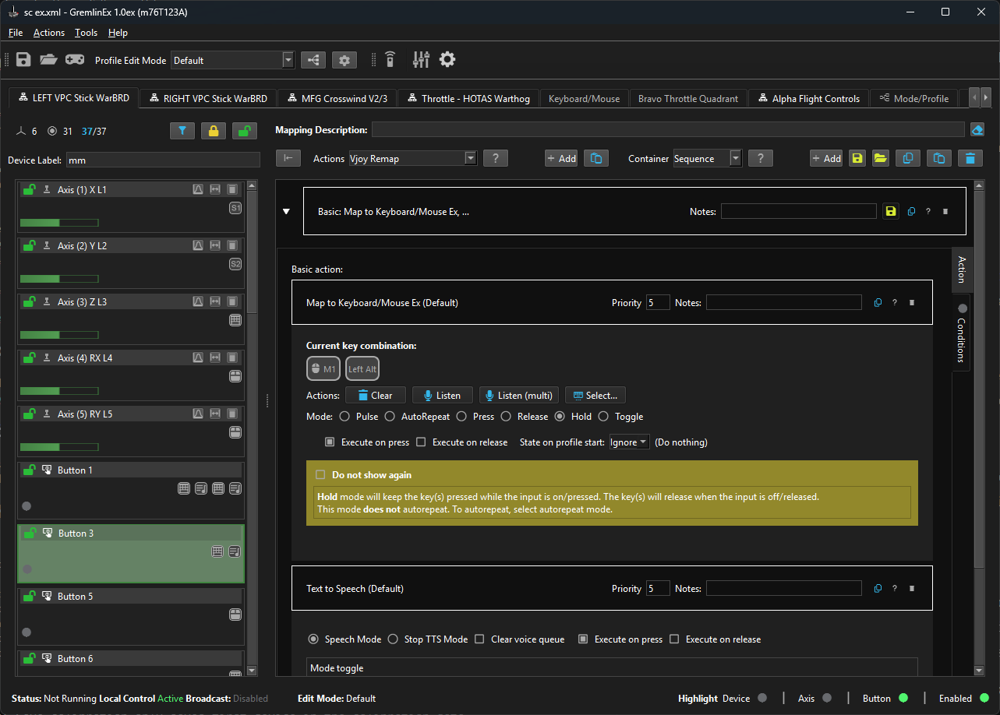
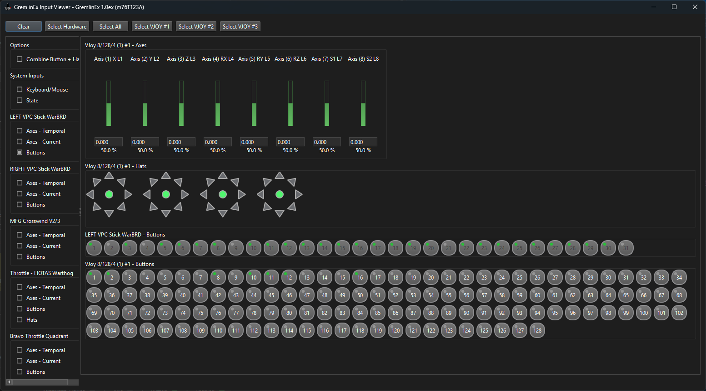

# GremlinEx

GremlinEx (GEX) is a universal controller integrator: it allows you to take input from multiple hardware devices from different manufacturers connected to a local machine, or a remote machine, such as joysticks and HID controllers, OSC (Open Sound Control), MIDI, Keyboard and mouse inputs and map them to virtual outputs like VJOY, or keyboard or mouse output, convert text to speech and play sounds.  It can send output to a game or another process.

With OSC support, GremlinEx can receive input from custom designed glass (touch screen) surfaces, and supports two way communication to any device supported by BitFocus Companion such as the Elgato Streamdeck.  This communication is two-way so GremlinEx can also send data to a glass surface or an external hardware panel.

GremlinEx can be expanded using custom plugins written in Python.  

# Documentation

The documentation for GremlinEx has recently moved to GitHub Pages:  [Documentation](https://muchimi.github.io/JoystickGremlinEx)

For command-line switches, see [Command-line options](command_line.md).

# Discord

Please visit the [Discord](https://discord.gg/pNadcReth9) server for discussion, tips and development information.

# Support and donations

GremlinEx is a passion project dedicated to solving complex controller mapping challenges across a wide range of hardware from different manufacturers. It also introduces powerful features that are unavailable in many other applications, including commercial alternatives.

Developing and maintaining GremlinEx requires a significant investment of time, research, and ongoing development. As gaming platforms, hardware, and software continue to evolve, GremlinEx is continually updated, modernized, and improved based on both emerging technologies and the invaluable feedback and ideas shared by its community.

If GremlinEx has been helpful to you, please consider supporting its continued development with a donation.

Every contribution, regardless of size, is sincerely appreciated. Your support helps sustain the countless hours spent developing, maintaining, and improving the project.

There are two ways you can safely and securely contribute to the project:

- via GitHub's sponsorship program.
- via a Paypal direct donation

The links are the top of this project page, or on the right side under sponsorships. 

Again, thank you for your shared passion and for your generosity and support. It means a lot, and sponsors make a huge difference. 

# Test versions

The most current test releases will contain the latest bug fixes, features and optimizations.  Not all test releases are stable which is why they are not in the release channel.  However, many are.  Please make a backup of your profiles and enable the versioning option to keep files separate by version just in case, but there is about a year's worth of key updates since the last official release all in the test channel including several stable versions.

The test versions are available here: https://github.com/muchimi/JoystickGremlinEx/releases/tag/test

# Change log

### (m77T93)

- Change: API: Continued work on provisioning of temporary VJOY devices to allow profiles configured for VJOY to load when VJOY is not configured or installed. Undefined VJOY outputs will attempt to use Maestro defined devices instead if available.  The failover is determined at profile start.  The mechanism is meant to allow profiles designed for VJOY to run as-is with Maestro virtual devices (provided they exist).
- Fix: UI: changing a profile with the input viewer visible could cause a model exception if the state visualizer is active.
- Fix: API: capped the maximum number of gamepad devices GEX can create via Maestro to 4 as that is the maximum supported by the XINPUT API.
- Fix: DIST: build tools can push an old version of the setup program.
- Fix: API (sound): exception if the system has no defined audio output devices.
- Fix: API (voice): allow voice device to be enabled when no input audio device is found.
- Fix: UI: UI not visible if VJOY is not installed.

### (m77T92)

- New: DIST: (experimental) New installer option. This new deployment method is a traditional setup program to install GremlinEx and thus easier to use that the ZIP archive method.  The installer lets you install GremlinEx to a folder of your choosing, defaults to a different sub folders based on version, supports uninstall.
- New: DIST: packaged EXE is now versioned (for installer support).
- New: API: Virtual device fail-over mode.  Allows missing VJOY devices to use corresponding Maestro devices (if installed).  This enables joystick output to map to whichever virtual device exists on the target machine without a profile re-do for any new devices if Maestro is used (Maestro is exclusive and does not work along with VJOY/VIGEM). This option is enabled by default and can be changed from the runtime options.  Note: Maestro is currently disabled until testing finishes although it is completely functional in the test environments.
- Change: command line parameters are now temporary and do not change the main options unless the /persist flag is also set on the command line.  Persisting these options may cause issues when not using command lines without new parameters that disable these options.
- Change: BUILD: automate build process and versioning for packaging and installer creation.
- Fix: API: /r option can prevent the UI from re-enabling itself on profile stop.
- Fix: API: built-in argument parser does not handle negative parameters using Windows style command line parameters.

### (m77T91)
- Change: command line parameters were updated for new features, and our menu options may have changed to please read carefully.
- Change: archive change logs moved to separate file at the end of this readme.

Command line parameters use - or / as the prefix - example `/help` or `-help` for both Python style and Windows style parameters.
	
| Parameter | Description |
| --- | --- |
|/np /no-profile  | Do not load a profile on start (/r /p will be ignored if provided) |
|/p /profile | Optional profile XML to load. This parameter is optional and a file name can be provided directly without /p.  If provided, the file must exist or GEX will exit. |
|/mh /mousehook /no-mh /no-mousehook | Toggles the mouse hook.  If off, mouse inputs will be disabled in GEX.  This is used for diagnostics purposes. |
|/r /run | Automatically starts the profile on GEX if a profile is available. |
|/nr /no-r /no-run /no-start /no-autostart /no-as| Automatically disables profile auto start if a profile is available. |
|/as /autoswitch| Enables automatic profile switching for profiles associated with a process. This is also disabled if the profile cannot be found or if the /no-r |
|/no-as /no-autoswitch| Disables automatic profile switching for profiles associated with a process. |
|/voice | Enable the voice recognition module. |
|/no-voice | Disable the voice recognition module. |
|/overlay /ov| Enable the overlay module. |
|/no-overlay /no-ov| Disable the overlay module. |
|/sd /streamdeck | Enable the StreamDeck bridge module. |
|/no-sd /no-streamdeck | Disable the StreamDeck bridge module. |
|/osc | Enable the OSC (Open Sound Control) module. |
|/no-osc | Disable the OSC (Open Sound Control) module. |
|/midi | Enable the MIDI module. |
|/no-midi | Disable the MIDI module. |
|/theme light \| dark \| auto \| custom | Sets the application color theme.|
|/help /?| Shows a list of command line parameters|

### (m77T90A):
- Fix: API: axis inversion in map to vjoy

### (m77T90):
- Fix: UI: delete widget button auto size
- Fix: UI: exception if a profile is recalled and the last device was the voice recognition device
- WIP: Maestro: ongoing work on HID Maestro interface and bridge service.  Note features are currently disabled as development and testing continue.
- Legal: update third party licensing and project information
- DOC: additional updated documentation and usage guides for m77 (WIP)

### (m77T89):
- Fix: Overlay: exception on HexArgb constant
- WIP: Maestro: ongoing work on HID Maestro interface and bridge service.

### (m77T88):
- Change: Maestro: initial code check-in for the upcoming new bridge module and interface to HIDMaestro. Add GEX module/support for output to VJOY and Maestro devices using the same mapping actions.  Note: The module is currently disabled in this release and there will be more information on this later as this moves further along.
- Fix: Overlay: widgets may not become enabled on profile stop.
- Fix: States: a newly filtered input may not display the corresponding mapping information if it was in the same position before the filter was applied.

### (m77T87):
- New: KVM Action: (feature request): enable local and KVM output based on the current remoting mode (local or remote).  If local and remote are concurrently enabled, this will concurrently forward kbd and mouse to the client and local machine.
- New: Input Viewer: **Select Used** button added.  This will automatically select inputs and outputs in use in the current profile based on input configuration and mapping data.
- Change: API (State): added a re-entry guard for state changes to abort state changes resulting from a prior state change (causing a loop).
- Change: API (Overlay): a new OCR request will cancel the prior OCR in progress to avoid a potential loop and trigger based on OCR results.
- Change: Control Action: added a control command to stop an OCR action in progress.  This allows a mapping to stop a prior OCR if needed as part of a mapped input.
- Change: UI (options): refactor UI to use updated widgets for consistent look/feel
- Change: UI (inputs): add input filter for lower end systems for a page size of 8.
- Change: Input Viewer: polish to show VJOY devices sorted by the VJOY device number and display hourglass (wait cursor) while updating.
- Fix: API (input viewer): reload device list on device rescan.
- Fix: UI: Device headers could disappear on profile load and bug fix for device icons not showing (this was previously turned off due to a widget issue). Mapped icon is now visible again.
- Fix: API: bug fix in the profile API list_actions that could cause an exception.

### (m77T86):
- Fix: API: reworked the UI thread invoker to eliminate the need for a QT object (this should reduce overhead) and removed parameter limits.
- Fix: UI (overlay): added a missing context parameter to the OBS Overlay UI thread switcher that could cause a hard crash (was unable to reproduce a crash on demand but this is based on the QT documentation as a potential gotcha).
- Fix: UI (input viewer): reworked the axis timeline widget call path to minimize QT context switching.
- Fix: UI (input viewer): resolved an issue where the timeline widget did not close when the trash button is clicked.
- Fix: UI: rework of wait cursor (hourglass) logic to resolve the wait cursor not always indicating a busy status while the UI refreshes or a long running task is executed.
- Fix: API (OSC): resolved an exception in the new OscData model.
- Fix: UI (OSC): resolved an issue where, in highlight mode, an input was no longer selected when the corresponding OSC input is received at design time.
- Fix: UI (OSC): resolved an issue where input filtering by name did not sync with the new pagination feature. Resolved another issue with filtering not always refreshing the matching input list with the new filter API.

### (m77T85A):
- Change: API: general first pass optimizations on m77
- Change: API: refactor of mouse and keyboard output call paths for reduced overhead low level I/O and optimized call paths/waiting.
- Fix: KVM Action: correct hat handling and possible packet loss of keyboard data.
- Fix: API (remoting): resolve serialization of hat position data, keyboard and gamepad and possible out of order processing.
- Fix: UI: Flow layout: streamline and reduce overhead.
- Fix: API: mouse - wake on motion or stop only.

### (m77T85):
- New: Vjoy Remap Action: Stepped axis mode gains a **stepped+PID** mode. In **Stepped** mode, the axis value is immediately set to the step.  In the **Stepped+PID** mode, the axis value smoothly transitions over time to the new step value using a PID controller.  This can be useful in applications where a smooth transition is desired, such as a speed limiter, trim or continuous flap function.
- New: Vjoy Remap Action: stepped modes now show steps on the input slider.
- New: Vjoy Remap Action: stepped modes gain a preset button to select from various stepped presets.
- New: Vjoy Remap Action: stepped axis mode gains as a default **auto step**. Selecting this step will, on profile start, read the current output axis and pick the step closest to the starting position. This is helpful when stopping/starting a profile to keep a previous output position on the axis.
- Change: UI: slider now supports moving handles via the mouse wheel.
- Fix: UI: fixed an issue when a disabled float and integer widgets could be changed via the mouse wheel.
- Fix: UI: fixed an issue with input mapping descriptions not visible, and there is now a distinction made between input description which is dependent on the input, vs mapping description which is a manual entry so they don't conflict with each other.
- Fix: Vjoy Remap Action: fixed an issue with latched keys not aggregating to a single key when using keyboard latching.
- Fix: API (Keyboard): getKey() could return duplicated latched keys.

### (m77T84):
- Change: UI: GEX active profile icon now propagates to the main application in addition to the system tray icon.
- Change: Vjoy Remap Action: Refactor to use new axis input API for UI events.
- Fix: Vjoy Remap Action: Merged axis widget exception if not yet created when the action is in merge axis mode.
- Fix: Vjoy Remap Action: Merged axis repeater does not always update.
- Fix: API: some handlers for vjoy as input did not refactor correctly during last parameter change.
- Fix: UI: system tray icon no longer updates when the profile is active due to a recent activation chain change.
- Fix: UI: resolved a tear-down chain gap that prevented some UI components from being disposed.

### (m77T83):

- New: UI (experimental): custom color theme (this may not presently entirely work as intended as more testing is needed).  This is available under theme options in the UI configuration options and brings up a custom dialog.  Presently a number of color usage descriptions may not make a lot of sense at this point, nor indicate where they are used.  The custom theme can be saved.  A GEX restart is required after making changes.
- New: DOC: New user guide for [Map to Vjoy](https://muchimi.github.io/JoystickGremlinEx/actions/map_to_vjoy_user_guide/)
- New: DOC: New user guide for [Gated Axis Action](https://muchimi.github.io/JoystickGremlinEx/actions/gated_axis_user_guide/)
- New: DOC: New user guide for [Map to Keyboard/Mouse EX Action](https://muchimi.github.io/JoystickGremlinEx/actions/keyboard_ex_user_guide/) 
- Change: DOC: started updating the documentation for m77.
- Change: UI: adjusted some light mode colors for improved contrast.
- Change: Input Viewer: Added tooltips to state visualizer buttons - expression states will include their definitions.
- Fix: UI: last input recall fails when no profile exists.
- Fix: API (Keyboard Device): key latching (pressing multiple keys in a shortcut defined as inputs in the keyboard device) may not always trigger depending on the order of the keys (or mouse inputs) pressed due to a change in the keyboard API, as well as changes in the execution engine recognition logic.  This is resolved.
- Fix: Map to Vjoy action: output curve dialog stopped dynamically updating with input changes.
- Fix: API (States): resolved a tear-down logic issue when a state is deleted and calls look for a non existent state while the UI is being updated.
- Fix: API (profile): stop attempting to update devices that are readonly (special devices).

### (m77T82):

- New: Map to VJoy action: stepped axis mode gains a PID mode. PID stands for Proportional-Integral-Derivative controller.  This mode uses an adaptive algorithm commonly found in cruise-control or setpoint applications: in this case, it allows a target value (setpoint) to be designated on an axis, and over time GEX will generate axis output values that drive toward that setpoint using a smooth curve.  The more the current axis value deviates from the target setpoint, the steeper the acceleration curve (the faster the rate of change). The target (setpoint) value is set by the increase/decrease inputs mapped to the action.  The curve is computed dynamically and will smooth out automatically as the output value nears the set point which prevents jerky movements.  The PID mode differs from the other modes in that it takes time and deviation from the new setpoint into consideration when setting the target value, resulting in a smooth output.  Example application: setting a target speed, or setting a trim value.  Default parameters can be changed to change how fast or slow PID algorithm responds.
- New: Map to Vjoy action: ability to set the initial axis value on profile start when using the stepped mode.
- Fix: API (State): ensure default value a state reports is off/released if the state value is not defined yet.
- Fix: API (State): add aliases for older API calls to avoid exception with older references in the UI.
- Fix: API (engine): Refactor execution engine data lookups and shortcut condition logic handling to improve runtime response.
- Fix: UI (Curve Editor): default dialog size should now fit its contents without having to resize.
- Fix: Input Viewer: clear button does not clear state visualizer. 

### (m77T81):
- Fix: API: TriggerDict: fix for internal Python copy operation exception depending on  key/value data types and dundar updates for comparison calls.
- Fix: Repeater container: ported to new container API/data model.
- Fix: Config: add Octavi IFR1 to list of modules that can be disabled if not used, which avoids running a monitoring loop if the device is connected but not used.
- Fix: API: low level keyboard/mouse performance pass. Eliminated win32 library, use ctype calls directly.  Mouse wheel move from timers to single scheduler to reduce threads and overhead. 
- Fix: API: event handling rework and performance pass to reduce timer usage and blocking loops, reduction in lookups.
- Fix: API: axis input filter rework and performance pass. Move from timers to a single scheduler. EMA code branching streamlining.
- Fix: API: legacy macro engine scheduler rework and performance pass.
- Fix: API (voice): if voice device is disabled, the voice module will not attempt to load voice related inputs from the profile.

### (m77T80):
- New: API: generic data model gains multiple concurrent filters.  Each registered filter type can have its own custom callback to determine if the data in the model is filtered or not.  If no filter is provided, the default filter is used.  This feature enables the data models to support multiple concurrent filters to have different views of the same data while using the same model.
- Change: Input Viewer: State repeater has filters re-enabled and uses the new state filter used in the state device.  The two share the same saved filter profiles for states can be called up in the input viewer. The filter options for states in Input Viewer is a separate set from the one used in the state device.  However they share the same saved filters (if any).
- Change: TempoEx Container: automatic disable log message now indicates which input contains the disabled TempoEx.
- Fix: UI: Device and mapping content disabled while the profile is running. This previously was only disabling some components while still allowing some UI interactions at profile runtime that could impact performance or introduce unexpected out of band changes.
- Fix: LOG: reduced density of forced verbosity some recently modified GEX components avoid spamming the log file with development related diagnostics information.
- Fix: States Device: Filter not always aware of profile states.

[Older change logs](archive_change_log.md)
