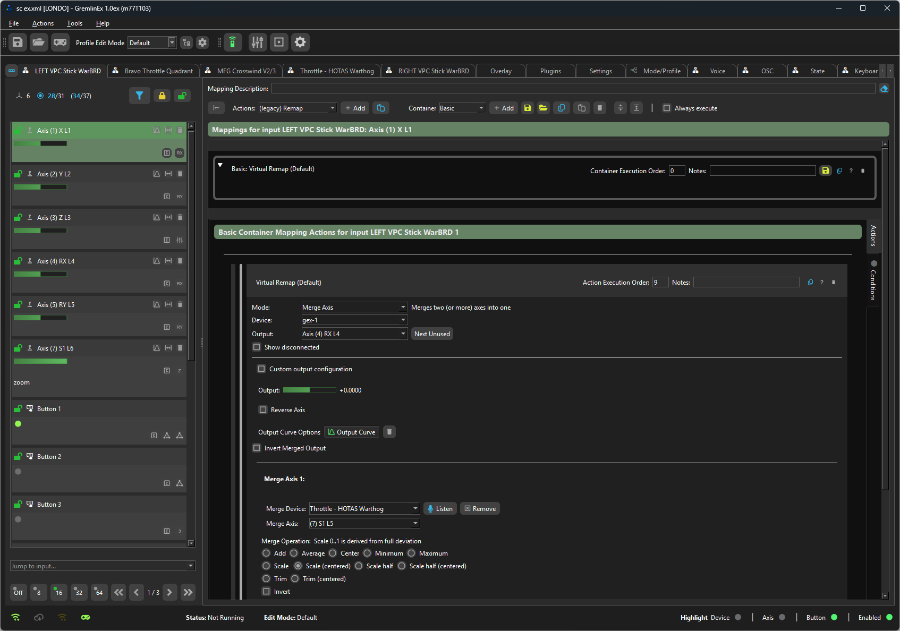
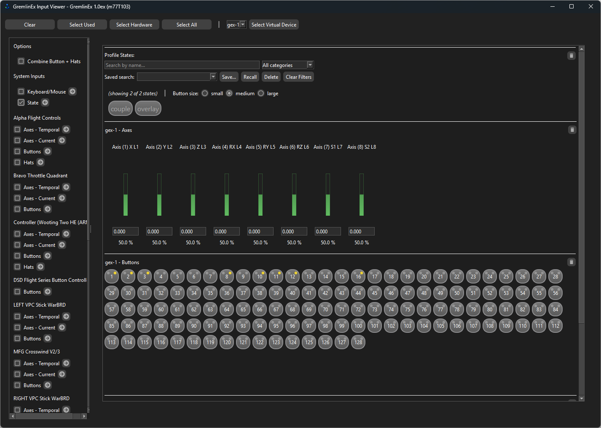

# GremlinEx

GremlinEx (GEX) is a universal controller integrator: it allows you to take input from multiple hardware devices from different manufacturers connected to a local machine, or a remote machine, such as joysticks and HID controllers, OSC (Open Sound Control), MIDI, Keyboard and mouse inputs and map them to virtual outputs like VJOY, or keyboard or mouse output, convert text to speech and play sounds.  It can send output to a game or another process.

As of m77T90, for virtual programmable joysticks and gamepads, GEX supports both vJoy/VIGEM and the newer HID Maestro virtual devices.  The support for HID Maestro is built-in the GEX Maestro Bridge service.  Note that you cannot have both vJoy/VIGEM and the bridge service running concurrently due to driver level conflicts external to GEX.

With OSC support, GremlinEx can receive input from custom designed glass (touch screen) surfaces, and supports two way communication to any device supported by BitFocus Companion such as the Elgato Streamdeck.  This communication is two-way so GremlinEx can also send data to a glass surface or an external hardware panel.

GremlinEx can be expanded using custom plugins written in Python.

# Documentation

The documentation for GremlinEx has recently moved to GitHub Pages:  [Documentation](https://muchimi.github.io/JoystickGremlinEx)

For command-line switches, see [Command-line options](command_line.md).

# Discord

Please visit the [Discord](https://discord.gg/pNadcReth9) server for discussion, tips and development information.

# Support and donations

GremlinEx is a passion project dedicated to solving complex controller mapping challenges across a wide range of hardware from different manufacturers. It also introduces powerful features that are unavailable in many other applications, including commercial alternatives.

Developing and maintaining GremlinEx requires a significant investment of time, research, and ongoing development. As gaming platforms, hardware, and software continue to evolve, GremlinEx is continually updated, modernized, and improved based on both emerging technologies and the invaluable feedback and ideas shared by its community.

If GremlinEx has been helpful to you, please consider supporting its continued development with a donation.

Every contribution, regardless of size, is sincerely appreciated. Your support helps sustain the countless hours spent developing, maintaining, and improving the project.

There are two ways you can safely and securely contribute to the project:

- via GitHub's sponsorship program.
- via a Paypal direct donation

The links are the top of this project page, or on the right side under sponsorships.

Again, thank you for your shared passion and for your generosity and support. It means a lot, and sponsors make a huge difference.

# Test versions

The most current test releases will contain the latest bug fixes, features and optimizations.  Not all test releases are stable which is why they are not in the release channel.  However, many are.  Please make a backup of your profiles and enable the versioning option to keep files separate by version just in case, but there is about a year's worth of key updates since the last official release all in the test channel including several stable versions.

The test versions are available here: https://github.com/muchimi/JoystickGremlinEx/releases/tag/test

# Change log

### (m77T108A)

- Fix: Missing references in the package to moved files for map to application 
- Fix: XML handling of special characters due to change in encoding handling in the project.

### (m77T108)

- New: Map to Application action: added an application picker similar to Spy++'s picker.
- Change: Map to Application action: added presets folder in the plugin (courtesy @johnb_vhgjb)
- Change: Map to Application action: moved to updated standards (widgets, linter).
- Change: UI: vjoy conditions are renamed to virtual conditions to reflect that a virtual device can be a bridge device or a vJoy device.
- Fix: Virtual Remap action: in failover mode, initial profile start axis state did not use the failover device causing a device not found exception.
- Fix: Virtual Remap action: in failover mode, it was possible for a vjoy condition to not use the failover device.
- Fix: Overlay: in failover mode, the overlay module may still be looking for vjoy devices, not the failover device, causing an exception.
- Fix: API (Modes): resolved an issue where some mode parenting information is lost and persisted to the profile as a top level mode due to new API supporting multiple virtual devices causing it to think the modes are separate.

### (m77T107)
- New: API (DILL): DILL (the GEX C++ component) was updated to use XINPUT for gamepads XINPUT instead of DINPUT.  DINPUT is not well supported by current generation gamepads nor by Microsoft which has presented some odd issues. This will change the device GUID in an existing profile and it will need to be remapped via Tools > Device Remap...  There is no change in functionality as all of this is handled/translated at the C++ level.  New DILL version 1.6.2.0 bundled with GEX.  This will be installed with the\ GEX update and is not separately installed.  

**IMPORTANT**

1. This change will update gamepad device GUIDs and it will need to be changed in Tools > Device Remap... to the new device.  Both the name and the GUID will change so a default cannot be selected automatically for you by GEX.
2. XINPUT devices not previously showing may now appear since they are now detected. 
2. Gamepad controller axis reporting and API level mapping is different under DINPUT and XINPUT.  You may need to also remap axes in any older profiles.  To do this you can use the copy/paste but it may be a bit more involved.  You can run the old version of GEX and use the template save feature, and load that into the new version if you have a complex mapping for the axes.
3. Buttons and hats should be the same however should be verified just in case.
 
- New: Virtual Remap: new curved output option to **button to axis** modes.  An optional output curve can be applied to the previously computed axis output when using encoders or stepped axis.
- New: Curve Editor: Added ability to select segments, segment drag and ability to spit a segment.  Smooth and straighten options apply to selected segment.
- New: Curve Editor: Added mathematical curve computational presets for logarithmic and s-curve (cubic smoothstep) curves, and an option for low/center/high as to where the curve inflection. The presets have stength modes applied as well.  These can be manually edited once set as they all map to Bezier points.
- New: Curve Editor: added fit option from a list of points - either single values for evenly spaced data, or curve coordinates (x, y pair per line).  This is to facilitate the entry of curves that need to go through a very specific data point or if a external curve data needs to be imported into a GEX curve.
- New: Curve Editor: added mirror x/y buttons.
- New: Curve Editor: GEX can smooth or straighten curve segments via a button.  

- Fix: UI: exception on message box call when the profile is running and attempting to remap device GUIDs.
- Fix: API: Further polish on profile button state sync when they conflict.  The active button will take precedence over a sync over an inactive button on profile start, if sync is selected and the buttons are latched.
 

### (m77T106)

#### This patch includes major enhancements related to remote control.

- New: API (Remote): GEX now maintains an optional list of remote clients that persists across profiles. This allows the master GEX instance to define and keep a list of target clients on the local network for selective output purposes when the profile is in remote control mode. The list of clients is available through Tools > Remote Clients or the remote options tab in global options.  The clients that show in this list only need to be listed if the profile wants to target a specific client for output at runtime (both axis/button/hat, keyboard, mouse and KVM).  Leave blank for the current default behavior of prior versions.
- New: Remote Action: This new mapping action allows an input to manipulate the output routing for remote clients and change the profile remote control setting at runtime.  The action includes a hold state for temporary behavior while pressed, and a toggle option.
- New: UI (Profile Settings): The profile settings page gains a remote client panel that lets you determine the remote control behavior on profile start.
- New: API: Added built-in buttons in GEX's remote options dialog to configure the Windows firewall, if needed, to support GEX networking.  This will prompt for elevated admin rights if needed, and will create an inbound rule to allow UDP traffice for GEX on the specified port (default 6012).
- New: API: Added testing for connectivity from within GEX's remote options dialog box to test the configured parameters.
- New: API: Added for server selection on a remote client (not the master system), the ability to select the master GEX machine from the list of discovered Windows machines on the local network.  This is to more quickly find the IP address for that host.
- New: 1:1 mapper: added ability to do 1:1 mapping between gamepad device with the new Maestro virtual gamepads.
- New: Map to Application action:  Contribution to GEX by @Jopie - thank you!  The version incorporated here was updated slightly for hardening and to account for some behaviors that came up through regression and functionality testing.

- Change: UI: Added a new toolbar button to easily toggle server mode or client mode for GEX networking.  These two buttons are exclusive as master and client are exclusive, however each button can turn itself off as well.

- Fix: Input Viewer: layout issue with the button repeaters and possible clipping of some of the visuals depending on scale and aspect ratio.
- Fix: Input Viewer: input viewer does not update virtual devices when the data comes from the GEX master.
- Fix: API (Remote): resolved an issue when a remote client was not finding the Maestro device to map to causing no output for that device.
- Fix: UI (Input Viewer): state visualizer filter options can produce incorrect results.
- Fix: Vjoy Remap action: when sync on start selected, did not always trigger the correct action if not a button/axis/hat action.
- Fix: 1:1 mapping tool: resolved an issue with 1:1 mapping with the new virtual device API and added support for Maestro devices, both joystick and gamepad.

### (m77T105)
- Change: UI:  Device Remap dialog gains a status icon indicating if the device is matched, not matched but a suitable remap was automatically map, and undetermined (no device was automatically derived).  
- Change: UI:  Device Remap dialog: GEX will attempt to guess a device to remap for operating system GUID changes.
- Change: UI:  Device Remap dialog: GEX will auto select a device row for remap if the  current device is different from the target device.
- Change: API: general code housekeeping.
- Fix: UI: Device Filter dialog: exception when sorting devices that do not report a name.

### (m77T104)
- Fix: UI: resolve special character encoding resulting in some UI garbled text due to a code formatting change.  This impacts several UI elements across all modules but does not change functionality.
- Fix: UI: device order may change automatically and not respect set preferences in the device filter.  
- Fix: UI: default device order may not be respected and add discovered devices out of sequence in the device list.

### (m77T103)
- Change: API (Maestro): allow GEX to create up to 256 devices - up from 16.  The first 16 will be the failover devices for vJoy.  **Requires bridge version 0.1.3**.
- Fix: API (Maestro): changed usage of HID descriptors to account for some applications including joy.cpl requiring some metadata to be unique to distinguish between devices.
- Fix: API (Maestro): fixed several potential deadlocks when tearing down, adding or removing devices as a batch operation could cause a deadlock due to concurrent updates/sync with DINPUT.  This could cause the UI to become unresponsive.
- Fix: API (Maestro): fix an issue with potential aliasing of older GUIDs that would not make them visible in the profile device GUID remapper, prompting a runtime warning a virtual device could not be found.
- Fix: UI (Input Viewer): possible duplicated panels for some devices due to aliases making it look like a different device when it is the same.  If this occurs, the additional devices will be discarded.  The API now checkes for the product/vendor HID descriptor to determine which GUID to use, and ensure the GUID is the one reported through DINPUT.
- Fix: UI (Maestro): preset creation could create a refresh race condition.
- Fix: BRIDGE: allow installer to re-install same version of the service.

### (m77T102)
- Change: PLATFORM: Python 3.14.10 (3.15 not yet supported due to underlying dependencies not all yet supporting 3.15). Update to the GEX dill library 1.6.1 (adds new optimizations and additional functionality specific to GEX at the C++ level).
- Change: UI (Maestro): allow all joystick and gamepad Maestro devices on the display list and allow GEX to delete them if needed (this is to view and clear any stale entries or entries not created by GEX).
- Fix: Device Information: removed stale cached entries.
- Fix: API (Maestro): device lookup and failover mapping could in some cases use the incorrect slot index or use an inactive Maestro devices if it matched by name.
- Fix: API (Maestro): revised logic for duplicated devices and clarification of service id vs name (two or more devices with the identical name but different service IDs reported by Maestro).
- Fix: API (Maestro): DINPUT sync timeout on already synchronized devices
- Fix: UI: device tabs do not always update when (non failover) Maestro devices are discovered.
- Fix: API: filter call exception after device teardown for default input selection because the model was already cleared.
- Fix: API: potential race condition when rebuilding tabs during a reload operation while devices are changing that could lead to a crash.
- Fix: DILL: optimization when querying DINPUT data and fix for potential race condition when rapidly adding/removing devices when using Maestro. 

 

### (m77T101)
- New: new mechanism to update **both** profile input and output device references to new devices.  The updated device remaper is in the Tools > Remap Devices... menu.  The default selection attempts to match devices with changed IDs based on hardware attributes scanned by GEX.  The dialog is split in two groups - one for inputs, one for outputs.  The output section is specific to mapping vJoy entries to the new Maestro entries.  The input section is what to use when you have ID changes with your controllers.  The logic is updated to use new HIDAPI data to do device matching to provide suitable defaults, but it is not always going to work as expected and a manual selection may be needed. This action will change data in the profile automatically and alter IDs.  After confirming the changes via the apply button, a backup is made and the profile is reloaded with the changed data.  **MAKE PROFILE BACKUPS FIRST**
- Fix: very long load time when loading a profile referencing a disconnected device
- Fix: disconnected device tab could be missing the disconnect icon due to QT refactor
- Fix: failover mapping could miss some items.  There may still be some work to do on the device display to clear ghost devices.
- Fix: API: Axis state data could refer to a non existing device on profile reload if that device changed.

### (m77T100)

#### `**Important** This update requires a companion update to GEX bridge 0.1.2. if you are no longer using vJoy.`

 
- Change: UI (Device Information): add failover state on device information window if the vjoy device is a failover device (a failover device is a vjoy device that does not exist on the machine but is mapped to a corresponding Maestro joystick by GEX so profile references to vJoy still work without changing the profile). 
- Change: UI (Device Information): color code devices referenced in a profile but not currently detected.
- Change: API (Maestro): aligned device number with HID Maestro logic for enumerating HIDAPI devices so WIndows looks at them in sequence. This is an attempt at ensuring that the Maestro devices created by GEX are in the same sequence number as the device listing in Windows. **Requires Bridge 0.1.2 or higher** if you are running in Maestro mode.
- Fix: API (Maestro): resolve internal cache and DINPUT sync issue that could cause duplicate entries depending on the detection method, and when in time the detection occurs. 
- Fix: API (detection): correct virtual flag determination logic that could flag a device as virtual when it should be reported as physical.
- Fix: API (detection): check HIDAPI, XINPUT and DINPUT for cross-interface device duplication and check for stale entries.  This could cause duplicate devices, stale devices, device order enumeration issues.
- Fix: API (vJoy): reviewed older code sections that check for vJOY devices by index/ID to ensure the device is consistent across all calls and correctly pulls an automatic failover device if it exists.
- Fix: Pause Action: XML parsing of mode could result in an incorrect value.
- Fix: Chain Container: API compatibility for new m77 data structures, added QT memory management guardrail, step CRUD (create/remove/update/delete) and re-order behavior fixed for new API, timeout and restart handling and empty chain handling.
- Fix: Sequence Container: XML parsing bug fix that could result in a blank sequence and parameter issue.
- Fix: API (audio): pydub dependency not finding ffmpeg encoder due to a load order issue.

### (m77T99)
- Change: UI (Device Information): device information dialog adds a device type column.
- Change: Map to Vjoy action has been renamed to "Virtual Remap" as it supports mapping to virtual joysticks (and Maestro gamepads created by GEX).  This is a visual name only - profiles are unchanged.
- Fix: API: The vJoy detection for GEX and the installers now includes a driver level check for devices in addition to a registry check in case of stale installation entries.  The check looks for at least one configured device in vJoy. The lack of a configured vJoy device will be interpreted as vJoy being unavailable.
- Fix: API (Maestro): on startup, GEX will check all GEX devices (gex-n and gex-gp-n where n is the index number) to make sure they are unique.  The device order on the bridge will be used.  While the name doesn't matter (as in the vJoy device names), they matter to the profile designer to know which device is which.
- Fix: UI: old log dialog deprecated as it does not support large log files nor special ANSI encoding.  Logs can be viewed and will call up the log file in the system's default editor.

### (m77T98)
- Change: (setup): vJoy detection is now setup as a warning rather than a hard stop:  the detection of vJoy is registry scan based and these may still persist on a system after vJoy is uninstalled.  Setup will still allow the installation of the bridge after displaying a warning in case it's a false-positive.  This warning does not show if the system never had vJoy installed.
- Change: API: On profile start, GEX will check for a virtual output being available if used in the profile, and display a warning message to the effect if GEX did not find a suitable output path for those.  The profile will still run but notify that a virtual output device is not available.  This warning only displays if a mapping exists that results in a virtual axis, button or hat output, but no virtual output device (vjoy or Maestro) is found for it.
- Change: API: refactored a number of UI related widget references application wide and converted more older UI elements to the newer versions for style consistency.
- Fix: UI (Maestro): individual or all device delete does not refresh the device list properly.
- Fix: UI (Maestro): fix for exceptions due to a refactor still having references to a widget that no longer exists in the UI.

### (m77T97)
- Change: API: Startup sequence modified to probe virtual device options.  If VJOY is installed, Maestro will not be queried by default.  If VJOY is not installed, GEX will actively look for the bridge and issue a warning if the bridge is not located.  If located, it will test connectivity and automatically enable Maestro devices.
- Change: (setup): The installer will run a connectivity probe against the bridge service and also check for installed versions as part of the GEX installation.
- Change: API: additional pass on all vjoy output paths to ensure they support Maestro devices (this touches on Overlay, AFCS, Split Axis, Merge Axis, Remap, Macro, etc...)
- Fix: (setup): The installer will run GEX using a shell prompt to display any UAC warnings that come up if "run GremlinEx" is selected when installation completes.
- Fix: API (Maestro): default to localhost mode if Maestro is not found at first check.
- Fix: UI (Maestro): reply port not visible in localhost mode.
- Fix: API: various fixes to entity paste operations (container, action or condition) linked to new data models in m77
- Fix: UI (Input Viewer): does not update Maestro virtual device repeaters.
- Fix: UI: additional work on teardown of UI elements to prevent QT memory desync.

### (m77T96)
- Change: UI: add virtual failover indicator on the UI to indicate when failover mode is active on Vjoy Remap, legacy Remap and Profile Settings page.
- Change: API: added support for both VJOY and Maestro defined joysticks as input (virtual joysticks will not display as input device unless configured in profile settings).
- Change: UI (filter): show filtered devices color coded.
- Fix: UI: pressing "no" on save calibration prompt does not close the underlying calibration dialog box.
- Fix: UI: changing a mode can cause the status bar mode repeater to not update to the curren mode.
- Fix: UI: rebuilding the mode list selects the default mode, not the prior selected mode.
- Fix: UI: button widget should stop emitting events if it is being deleted.
- Fix: UI (Profile Settings): validate input devices can in fact be used as inputs.  There was only one type of virtual device before, now there are several so the UI was assuming there was only one type.
- Fix: UI: checkbox style not always resolving its state icons.
- Fix: UI: filtered device fallback tab selection (if device is invisible or not present) could fail.
- Fix: UI: adjust dialog restore position if no longer visible due to a resolution or monitor change.
- Fix: Vjoy Remap Action: update relative mode and set start value causing an exception (broken by recent API changes for startup sync).
- Fix: VJoy Remap Action: virtual output device identifiers could overlap for gamepad and joystick Maestro devices with the new unified virtual output API.

### (m77T95)
- Change: UI (Maestro): added host scan button to scan for the GEX bridge host.
- Change: UI (Maestro): added localhost mode to simplify the bridge configuration setup.
- Change: API (Maestro): attempt automatic host discovery on initial start starting with localhost.
- Fix: UI: Device visualizer widget exception on teardown.
- Change: Maestro: simplify localhost usage and detection on initial start.  Default in localhost mode to match service default configuration (assume the bridge is on the same machine as GEX).
- Fix: API: ffmeg default location scan.
- Fix: UI (Maestro): exception when changing host IP addresses in Maestro configuration window.
- Fix: API (Maestro): automatic bridge discovery only scans TCP, not UDP and does not start by scanning localhost.

### (m77T94)
- New: Bridge: (experimental) Maestro bridge support enabled by default. **potential for undiscovered dragons ahead as this is experimental.**.  See the [bridge testing manual](https://github.com/muchimi/JoystickGremlinEx/blob/develop/maestro%20testing.md) on what to do, how to test.
- New: UI: if the bridge is detected and no gex joystick devices are found, will offer to create standard output joystick devices defaulting to 4.
- Fix: UI: remote Maestro IP does not update the configuration when manually edited.
- Fix: UI: adding a Maestro device manually via the new device button clears the device list.
- Fix: API: Maestro ping command sends duplicate request.
- Fix: UI: mode delete does not update the list of modes after deletion.
- Fix: Gated Axis Action: gate widgets do not update correctly when a gate is deleted.
- Fix: BUILD: exception in bridge installer, remove device creation option (moved to GEX  app).
- DOC: more documentation updates.

### (m77T93)

- Change: API: Continued work on provisioning of temporary VJOY devices to allow profiles configured for VJOY to load when VJOY is not configured or installed. Undefined VJOY outputs will attempt to use Maestro defined devices instead if available.  The failover is determined at profile start.  The mechanism is meant to allow profiles designed for VJOY to run as-is with Maestro virtual devices (provided they exist).
- Fix: UI: changing a profile with the input viewer visible could cause a model exception if the state visualizer is active.
- Fix: API: capped the maximum number of gamepad devices GEX can create via Maestro to 4 as that is the maximum supported by the XINPUT API.
- Fix: DIST: build tools can push an old version of the setup program.
- Fix: API (sound): exception if the system has no defined audio output devices.
- Fix: API (voice): allow voice device to be enabled when no input audio device is found.
- Fix: UI: UI not visible if VJOY is not installed.

### (m77T92)

- New: DIST: (experimental) New installer option. This new deployment method is a traditional setup program to install GremlinEx and thus easier to use that the ZIP archive method.  The installer lets you install GremlinEx to a folder of your choosing, defaults to a different sub folders based on version, supports uninstall.
- New: DIST: packaged EXE is now versioned (for installer support).
- New: API: Virtual device fail-over mode.  Allows missing VJOY devices to use corresponding Maestro devices (if installed).  This enables joystick output to map to whichever virtual device exists on the target machine without a profile re-do for any new devices if Maestro is used (Maestro is exclusive and does not work along with VJOY/VIGEM). This option is enabled by default and can be changed from the runtime options.  Note: Maestro is currently disabled until testing finishes although it is completely functional in the test environments.
- Change: command line parameters are now temporary and do not change the main options unless the /persist flag is also set on the command line.  Persisting these options may cause issues when not using command lines without new parameters that disable these options.
- Change: BUILD: automate build process and versioning for packaging and installer creation.
- Fix: API: /r option can prevent the UI from re-enabling itself on profile stop.
- Fix: API: built-in argument parser does not handle negative parameters using Windows style command line parameters.

### (m77T91)
- Change: command line parameters were updated for new features, and our menu options may have changed to please read carefully.
- Change: archive change logs moved to separate file at the end of this readme.

Command line parameters use - or / as the prefix - example `/help` or `-help` for both Python style and Windows style parameters.

| Parameter | Description |
| --- | --- |
|/np /no-profile  | Do not load a profile on start (/r /p will be ignored if provided) |
|/p /profile | Optional profile XML to load. This parameter is optional and a file name can be provided directly without /p.  If provided, the file must exist or GEX will exit. |
|/mh /mousehook /no-mh /no-mousehook | Toggles the mouse hook.  If off, mouse inputs will be disabled in GEX.  This is used for diagnostics purposes. |
|/r /run | Automatically starts the profile on GEX if a profile is available. |
|/nr /no-r /no-run /no-start /no-autostart /no-as| Automatically disables profile auto start if a profile is available. |
|/as /autoswitch| Enables automatic profile switching for profiles associated with a process. This is also disabled if the profile cannot be found or if the /no-r |
|/no-as /no-autoswitch| Disables automatic profile switching for profiles associated with a process. |
|/voice | Enable the voice recognition module. |
|/no-voice | Disable the voice recognition module. |
|/overlay /ov| Enable the overlay module. |
|/no-overlay /no-ov| Disable the overlay module. |
|/sd /streamdeck | Enable the StreamDeck bridge module. |
|/no-sd /no-streamdeck | Disable the StreamDeck bridge module. |
|/osc | Enable the OSC (Open Sound Control) module. |
|/no-osc | Disable the OSC (Open Sound Control) module. |
|/midi | Enable the MIDI module. |
|/no-midi | Disable the MIDI module. |
|/theme light \| dark \| auto \| custom | Sets the application color theme.|
|/help /?| Shows a list of command line parameters|

### (m77T90A):
- Fix: API: axis inversion in map to vjoy

### (m77T90):
- Fix: UI: delete widget button auto size
- Fix: UI: exception if a profile is recalled and the last device was the voice recognition device
- WIP: Maestro: ongoing work on HID Maestro interface and bridge service.  Note features are currently disabled as development and testing continue.
- Legal: update third party licensing and project information
- DOC: additional updated documentation and usage guides for m77 (WIP)

### (m77T89):
- Fix: Overlay: exception on HexArgb constant
- WIP: Maestro: ongoing work on HID Maestro interface and bridge service.

### (m77T88):
- Change: Maestro: initial code check-in for the upcoming new bridge module and interface to HIDMaestro. Add GEX module/support for output to VJOY and Maestro devices using the same mapping actions.  Note: The module is currently disabled in this release and there will be more information on this later as this moves further along.
- Fix: Overlay: widgets may not become enabled on profile stop.
- Fix: States: a newly filtered input may not display the corresponding mapping information if it was in the same position before the filter was applied.

### (m77T87):
- New: KVM Action: (feature request): enable local and KVM output based on the current remoting mode (local or remote).  If local and remote are concurrently enabled, this will concurrently forward kbd and mouse to the client and local machine.
- New: Input Viewer: **Select Used** button added.  This will automatically select inputs and outputs in use in the current profile based on input configuration and mapping data.
- Change: API (State): added a re-entry guard for state changes to abort state changes resulting from a prior state change (causing a loop).
- Change: API (Overlay): a new OCR request will cancel the prior OCR in progress to avoid a potential loop and trigger based on OCR results.
- Change: Control Action: added a control command to stop an OCR action in progress.  This allows a mapping to stop a prior OCR if needed as part of a mapped input.
- Change: UI (options): refactor UI to use updated widgets for consistent look/feel
- Change: UI (inputs): add input filter for lower end systems for a page size of 8.
- Change: Input Viewer: polish to show VJOY devices sorted by the VJOY device number and display hourglass (wait cursor) while updating.
- Fix: API (input viewer): reload device list on device rescan.
- Fix: UI: Device headers could disappear on profile load and bug fix for device icons not showing (this was previously turned off due to a widget issue). Mapped icon is now visible again.
- Fix: API: bug fix in the profile API list_actions that could cause an exception.

### (m77T86):
- Fix: API: reworked the UI thread invoker to eliminate the need for a QT object (this should reduce overhead) and removed parameter limits.
- Fix: UI (overlay): added a missing context parameter to the OBS Overlay UI thread switcher that could cause a hard crash (was unable to reproduce a crash on demand but this is based on the QT documentation as a potential gotcha).
- Fix: UI (input viewer): reworked the axis timeline widget call path to minimize QT context switching.
- Fix: UI (input viewer): resolved an issue where the timeline widget did not close when the trash button is clicked.
- Fix: UI: rework of wait cursor (hourglass) logic to resolve the wait cursor not always indicating a busy status while the UI refreshes or a long running task is executed.
- Fix: API (OSC): resolved an exception in the new OscData model.
- Fix: UI (OSC): resolved an issue where, in highlight mode, an input was no longer selected when the corresponding OSC input is received at design time.
- Fix: UI (OSC): resolved an issue where input filtering by name did not sync with the new pagination feature. Resolved another issue with filtering not always refreshing the matching input list with the new filter API.

### (m77T85A):
- Change: API: general first pass optimizations on m77
- Change: API: refactor of mouse and keyboard output call paths for reduced overhead low level I/O and optimized call paths/waiting.
- Fix: KVM Action: correct hat handling and possible packet loss of keyboard data.
- Fix: API (remoting): resolve serialization of hat position data, keyboard and gamepad and possible out of order processing.
- Fix: UI: Flow layout: streamline and reduce overhead.
- Fix: API: mouse - wake on motion or stop only.

### (m77T85):
- New: Vjoy Remap Action: Stepped axis mode gains a **stepped+PID** mode. In **Stepped** mode, the axis value is immediately set to the step.  In the **Stepped+PID** mode, the axis value smoothly transitions over time to the new step value using a PID controller.  This can be useful in applications where a smooth transition is desired, such as a speed limiter, trim or continuous flap function.
- New: Vjoy Remap Action: stepped modes now show steps on the input slider.
- New: Vjoy Remap Action: stepped modes gain a preset button to select from various stepped presets.
- New: Vjoy Remap Action: stepped axis mode gains as a default **auto step**. Selecting this step will, on profile start, read the current output axis and pick the step closest to the starting position. This is helpful when stopping/starting a profile to keep a previous output position on the axis.
- Change: UI: slider now supports moving handles via the mouse wheel.
- Fix: UI: fixed an issue when a disabled float and integer widgets could be changed via the mouse wheel.
- Fix: UI: fixed an issue with input mapping descriptions not visible, and there is now a distinction made between input description which is dependent on the input, vs mapping description which is a manual entry so they don't conflict with each other.
- Fix: Vjoy Remap Action: fixed an issue with latched keys not aggregating to a single key when using keyboard latching.
- Fix: API (Keyboard): getKey() could return duplicated latched keys.

### (m77T84):
- Change: UI: GEX active profile icon now propagates to the main application in addition to the system tray icon.
- Change: Vjoy Remap Action: Refactor to use new axis input API for UI events.
- Fix: Vjoy Remap Action: Merged axis widget exception if not yet created when the action is in merge axis mode.
- Fix: Vjoy Remap Action: Merged axis repeater does not always update.
- Fix: API: some handlers for vjoy as input did not refactor correctly during last parameter change.
- Fix: UI: system tray icon no longer updates when the profile is active due to a recent activation chain change.
- Fix: UI: resolved a tear-down chain gap that prevented some UI components from being disposed.

### (m77T83):

- New: UI (experimental): custom color theme (this may not presently entirely work as intended as more testing is needed).  This is available under theme options in the UI configuration options and brings up a custom dialog.  Presently a number of color usage descriptions may not make a lot of sense at this point, nor indicate where they are used.  The custom theme can be saved.  A GEX restart is required after making changes.
- New: DOC: New user guide for [Map to Vjoy](https://muchimi.github.io/JoystickGremlinEx/actions/map_to_vjoy_user_guide/)
- New: DOC: New user guide for [Gated Axis Action](https://muchimi.github.io/JoystickGremlinEx/actions/gated_axis_user_guide/)
- New: DOC: New user guide for [Map to Keyboard/Mouse EX Action](https://muchimi.github.io/JoystickGremlinEx/actions/keyboard_ex_user_guide/)
- Change: DOC: started updating the documentation for m77.
- Change: UI: adjusted some light mode colors for improved contrast.
- Change: Input Viewer: Added tooltips to state visualizer buttons - expression states will include their definitions.
- Fix: UI: last input recall fails when no profile exists.
- Fix: API (Keyboard Device): key latching (pressing multiple keys in a shortcut defined as inputs in the keyboard device) may not always trigger depending on the order of the keys (or mouse inputs) pressed due to a change in the keyboard API, as well as changes in the execution engine recognition logic.  This is resolved.
- Fix: Map to Vjoy action: output curve dialog stopped dynamically updating with input changes.
- Fix: API (States): resolved a tear-down logic issue when a state is deleted and calls look for a non existent state while the UI is being updated.
- Fix: API (profile): stop attempting to update devices that are readonly (special devices).

### (m77T82):

- New: Map to VJoy action: stepped axis mode gains a PID mode. PID stands for Proportional-Integral-Derivative controller.  This mode uses an adaptive algorithm commonly found in cruise-control or setpoint applications: in this case, it allows a target value (setpoint) to be designated on an axis, and over time GEX will generate axis output values that drive toward that setpoint using a smooth curve.  The more the current axis value deviates from the target setpoint, the steeper the acceleration curve (the faster the rate of change). The target (setpoint) value is set by the increase/decrease inputs mapped to the action.  The curve is computed dynamically and will smooth out automatically as the output value nears the set point which prevents jerky movements.  The PID mode differs from the other modes in that it takes time and deviation from the new setpoint into consideration when setting the target value, resulting in a smooth output.  Example application: setting a target speed, or setting a trim value.  Default parameters can be changed to change how fast or slow PID algorithm responds.
- New: Map to Vjoy action: ability to set the initial axis value on profile start when using the stepped mode.
- Fix: API (State): ensure default value a state reports is off/released if the state value is not defined yet.
- Fix: API (State): add aliases for older API calls to avoid exception with older references in the UI.
- Fix: API (engine): Refactor execution engine data lookups and shortcut condition logic handling to improve runtime response.
- Fix: UI (Curve Editor): default dialog size should now fit its contents without having to resize.
- Fix: Input Viewer: clear button does not clear state visualizer.

### (m77T81):
- Fix: API: TriggerDict: fix for internal Python copy operation exception depending on  key/value data types and dundar updates for comparison calls.
- Fix: Repeater container: ported to new container API/data model.
- Fix: Config: add Octavi IFR1 to list of modules that can be disabled if not used, which avoids running a monitoring loop if the device is connected but not used.
- Fix: API: low level keyboard/mouse performance pass. Eliminated win32 library, use ctype calls directly.  Mouse wheel move from timers to single scheduler to reduce threads and overhead.
- Fix: API: event handling rework and performance pass to reduce timer usage and blocking loops, reduction in lookups.
- Fix: API: axis input filter rework and performance pass. Move from timers to a single scheduler. EMA code branching streamlining.
- Fix: API: legacy macro engine scheduler rework and performance pass.
- Fix: API (voice): if voice device is disabled, the voice module will not attempt to load voice related inputs from the profile.

### (m77T80):
- New: API: generic data model gains multiple concurrent filters.  Each registered filter type can have its own custom callback to determine if the data in the model is filtered or not.  If no filter is provided, the default filter is used.  This feature enables the data models to support multiple concurrent filters to have different views of the same data while using the same model.
- Change: Input Viewer: State repeater has filters re-enabled and uses the new state filter used in the state device.  The two share the same saved filter profiles for states can be called up in the input viewer. The filter options for states in Input Viewer is a separate set from the one used in the state device.  However they share the same saved filters (if any).
- Change: TempoEx Container: automatic disable log message now indicates which input contains the disabled TempoEx.
- Fix: UI: Device and mapping content disabled while the profile is running. This previously was only disabling some components while still allowing some UI interactions at profile runtime that could impact performance or introduce unexpected out of band changes.
- Fix: LOG: reduced density of forced verbosity some recently modified GEX components avoid spamming the log file with development related diagnostics information.
- Fix: States Device: Filter not always aware of profile states.

[Older change logs](archive_change_log.md)
