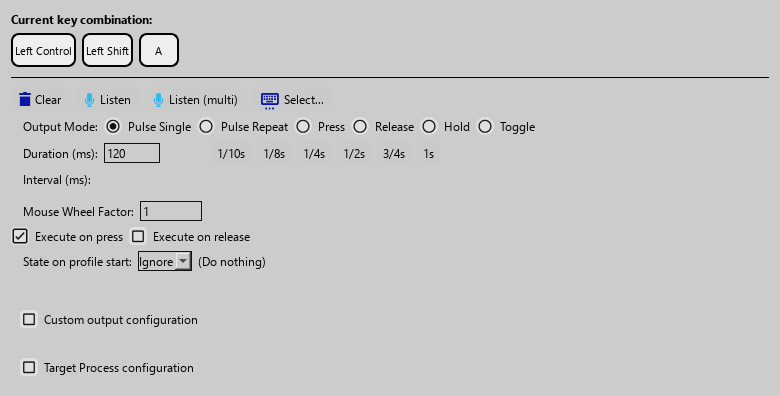
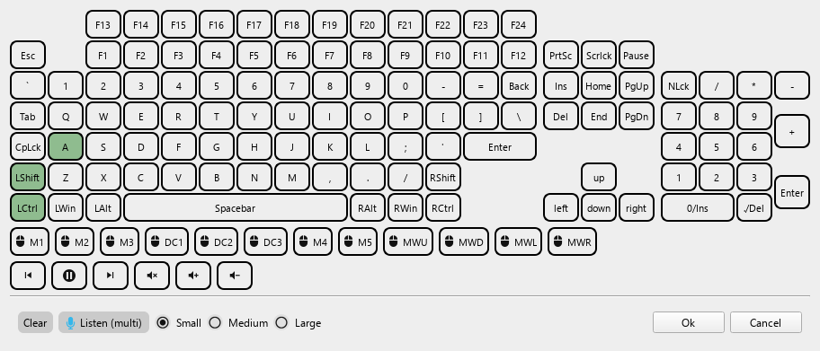
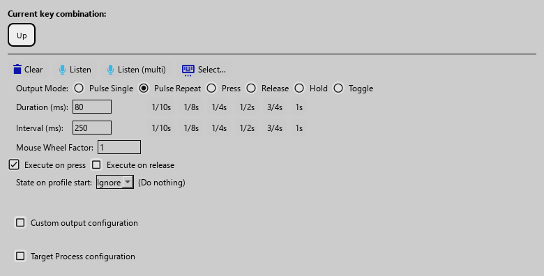

# Map to Keyboard/Mouse Ex User Guide

**Map to Keyboard/Mouse Ex** converts an input into a keyboard combination, mouse-button action, or mouse-wheel event. Use it to hold a command while a joystick button is down, send a timed shortcut, repeat a command, or control when an output is pressed and released.

## Contents

- [Before you start](#before-you-start)
    - [A combination is not a typing sequence](#a-combination-is-not-a-typing-sequence)
- [Create your first mapping](#create-your-first-mapping)
- [Choose keys and mouse inputs](#choose-keys-and-mouse-inputs)
    - [Record a shortcut](#record-a-shortcut)
    - [Select a shortcut visually](#select-a-shortcut-visually)
- [Choose an output mode](#choose-an-output-mode)
    - [Hold](#hold)
    - [Press and Release](#press-and-release)
    - [Pulse Single](#pulse-single)
    - [Pulse Repeat](#pulse-repeat)
    - [Toggle](#toggle)
- [Set duration and interval](#set-duration-and-interval)
- [Choose the triggering event](#choose-the-triggering-event)
- [Use mouse buttons and the wheel](#use-mouse-buttons-and-the-wheel)
    - [Mouse buttons](#mouse-buttons)
    - [Mouse wheel](#mouse-wheel)
- [Set the startup state](#set-the-startup-state)
- [Choose local, remote, or process output](#choose-local-remote-or-process-output)
    - [Normal local output](#normal-local-output)
    - [Remote output](#remote-output)
    - [Target a process](#target-a-process)
- [Worked examples](#worked-examples)
    - [Hold a push-to-talk key](#hold-a-push-to-talk-key)
    - [Send one shortcut](#send-one-shortcut)
    - [Repeat an adjustment while held](#repeat-an-adjustment-while-held)
    - [Separate “on” and “off” controls](#separate-on-and-off-controls)
    - [Send a command when a button is released](#send-a-command-when-a-button-is-released)
- [Test and troubleshoot](#test-and-troubleshoot)

## Before you start

Have a profile containing the source input and know the key or mouse command expected by the target application.

The action supports **joystick buttons and hats**. For a hat, configure a virtual-button activation condition for the direction you want to use.

To trigger a key when an axis crosses a position or enters a range, use a [Gated Axis](gated_axis_user_guide.md).

For your first test:

- Choose one source button.
- Use one output key.
- Leave process targeting off and test local output with the intended application focused.
- Keep **State on profile start** set to Ignore.

### A combination is not a typing sequence

The keys shown under **Current key combination** form a group of outputs. For example, `Ctrl + Shift + A` is one shortcut, not three separately timed keystrokes, like a **macro** or **sequence** would be.

The action sorts its keys for pressing and releases them in reverse order. Recording multiple inputs does not preserve typing pauses or create a timed macro. Use a sequence/macro action if you need “press A, wait, then press B.”

GEX sends modifiers before the other selected keys so the receiving application can recognize the shortcut.

## Create your first mapping

1. Select the profile mode and source joystick button.
2. Add **Map to Keyboard/Mouse Ex** to its action container.
3. Click **Select...** and choose the output key, or click **Listen** to capture one input.
4. Confirm that the key appears under **Current key combination**.
5. Select **Hold** under **Output Mode**.
6. Leave **Execute on press** checked and **Execute on release** unchecked.
7. Save and start the profile.
8. Focus the target application, hold the source button, and then release it.
9. Confirm that the output activates while held and stops when released.

For a brief command, choose **Pulse Single** under **Output Mode** and set **Duration (ms)**.

The example sends **Left Ctrl + Left Shift + A** for **120 ms** when the source button is pressed.

## Choose keys and mouse inputs

| Control | Use |
| --- | --- |
| Listen | Capture one key, mouse button, or wheel input. |
| Listen (multi) | Capture multiple keyboard or mouse inputs; confirm with OK when finished. |
| Select... | Choose keys through the virtual-keyboard dialog. **This is often the fastest and easiest option to select keys** |
| Clear | Remove the current output selection. |
| Right-click an output key, then Delete | Remove that key from the combination. |

### Record a shortcut

1. Select **Listen (multi)**.
2. Enter the shortcut you want to send, such as `Ctrl + Shift + A`.
3. Select **OK** in the listener.
4. Review the resulting combination before testing it.

The listener's tooltip states that clicks on its dialog buttons are excluded from the recorded selection. It accepts keyboard and mouse inputs.

### Select a shortcut visually

1. Select **Select...**.
2. Choose the required keys in the virtual keyboard.
3. Accept the dialog.
4. Check the displayed combination.

Selected keys are highlighted. Mouse buttons and wheel directions are below the keyboard, with media keys on the bottom row.

This method is the easiest and preferred method to select (or deselect) keys, as it lets you also pick keys that may not exist on your keyboard/input device.  For example, the media keys, the F13 to F24 keys, or all mouse buttons and horizontal wheel triggers, may all be hard to input using the **listen** mode.  This is also difficult if your keyboard is not a **100%** sized keyboard, does not have a numeric keypad or combines multiple keys like a **60%** keyboard.  The visual keyboard includes all standard keys, including many that are not on a normal keyboard but can be output to a game.

Pay attention to left/right modifiers or extended or numpad keys when the target application distinguishes them.  These keys report as different keys even if they normally produce the same output (a good example of that would be the **home** key or the **multiply** or **enter** keys).

For ordinary output mappings, select at least one key or mouse input.

## Choose an output mode

| Mode | Result | Use it for |
| --- | --- | --- |
| Hold | Presses the combination while the source is on; releases it when the source turns off. | Push-to-talk, momentary controls, or dragging with a mouse button. |
| Press | Sends key-down or mouse-button-down without an automatic matching release. | One control starts a held command. |
| Release | Sends key-up or mouse-button-up for the selected outputs. | A second control ends a held command. |
| Pulse Single | Presses the combination, holds it for Duration, then releases it. | Shortcuts and single commands. |
| Pulse Repeat | Repeatedly presses and releases the combination while the source is active. | Repeated adjustment or navigation. |
| Toggle | Changes each selected output to the opposite of its observed pressed state. | Alternating a held command on and off. |

### Hold

Hold follows the source input's state. Keep a normal source release path available so the output can be released.

Use **Pulse Repeat** when the receiving application needs separate press and release events for each repeat.

### Press and Release

Treat these as a pair when creating a persistent output:

1. Configure one source with **Press** and the desired combination.
2. Configure another source with **Release** and the same combination.
3. Verify both actions use the same output destination.
4. Test starting and ending the held command.

Releasing the source that triggered Press does not automatically send key-up. Stopping the profile does not provide the same explicit held-key cleanup for Press as it does for Hold.

### Pulse Single

Pulse Single sends one timed press and release. The pulse runs for the configured duration even if you release the source button early.

While a pulse is already running, another request for that same action is ignored. For rapid successive commands, choose a duration short enough to finish before the next trigger.

### Pulse Repeat

Pulse Repeat pulses the selected combination while the source is active. Releasing the source button, stopping the profile, or changing the runtime mode stops repetition.

Use the normal press-triggered configuration. The editor warns against execute-on-release operation for this mode; a release-only configuration does not provide the intended start/stop cycle.

### Toggle

Toggle checks the current observed state of each selected output and sends the opposite state. It is not a single stored on/off flag for the entire combination.

For predictable results, start with a single output key or mouse button. When toggling a combination, physical keys or other mappings can leave different members in different states. Provide a Release action if you need a definite “all selected outputs off” command.

## Set duration and interval

Timing controls use **milliseconds**.

| Setting | Applies to | Meaning |
| --- | --- | --- |
| Duration (ms) | Pulse Single and Pulse Repeat | How long the outputs remain pressed during a pulse. |
| Interval (ms) | Pulse Repeat | The pause between pulses. |

For example, a Duration of `100 ms` and Interval of `200 ms` describe a brief press followed by a longer gap. Use these as example values, not fixed product defaults.

New actions take their timing values from the application's last-used keyboard-mapper settings. Changing a timing value updates that preference. Do not assume every new action starts at `250 ms` or another fixed value.

If the target application misses a command, increase Duration. If repetition is too fast, increase Interval. Test with the target application before choosing very short timings.

## Choose the triggering event

The execution controls choose whether supported actions activate on the source **press**, **release**, or both.

For most mappings, begin with:

- Execute on press: enabled.
- Execute on release: disabled.

For **Press**, **Release**, **Pulse Single**, and **Toggle**, a qualifying source release can be used as the activation event. A **Release** output action can also run when you press the source button.

For example, **Pulse Single** with **Execute on release** sends a short shortcut when you let go of the source button.

Enabling both press and release can produce two activations per physical cycle. Avoid that for toggles or commands you want to send only once.

Use **Execute on press** for **Hold** and **Pulse Repeat**. Releasing the source ends the hold or stops repetition.

## Use mouse buttons and the wheel

Keyboard Ex can include mouse buttons and wheel events in its output selection as a convenience. It does not provide cursor-position or cursor-motion configuration.  The mouse **buttons** and **wheel** events are momentary events as well like other keys, which makes them particularly suitable to be mapped in this action.  It is also helpful to include mouse functions with other **latched keys** such as the usual modifier (`shift` or `alt` or `ctrl`, but also other keys.    For example in GEX, you can create a shortcut that includes `left ctrl + right shift + A + mouse 5`.

Internally, GEX creates special keys for these inputs and translates them to mouse output for the game / application to use, even if they appear in this action as keyboard keys.  This is a visual, convenience representation, not a special translation GEX does.

### Mouse buttons

Use the listener to select the desired mouse input, then choose its behavior:

- **Hold** keeps the button down while the source is held.
- **Pulse Single** produces a timed down/up pair.
- **Press** and **Release** let separate sources control the down and up operations.
- **Toggle** changes the observed button state.

If the combination includes a keyboard modifier and a mouse button, test the complete interaction in the target application.

### Mouse wheel

Select the desired wheel direction and set **Mouse Wheel Factor**. The field accepts values from **1 to 100**, with a supplied default of **1**.

The factor controls wheel movement per trigger. It does not select a repeat rate. Start at 1 and increase it only after verifying the direction and amount.

**Pulse Single** and **Pulse Repeat** use the default wheel factor. Check the amount of wheel movement in the target application when you change modes.

## Set the startup state

**State on profile start** offers Ignore and Input behavior.

| Choice | Behavior |
| --- | --- |
| Ignore | Does not issue an output merely to synchronize with the source at startup. This is the supplied default. |
| Input | Reads the source state and processes a corresponding input event when the profile starts. |

For joystick buttons, the action reads whether the button is held. For hats, it reads the current hat state; the surrounding direction/activation setup still matters.

Input synchronization uses the selected output mode. It can therefore press a key, start a timed operation, or toggle an output when the startup event qualifies. It is not limited to Hold.

Use Ignore when starting the profile should not send a command. Test Input synchronization with the source both held and released before using it in a regular profile. The supplied startup routine does not sample an axis position for this action.

## Choose local, remote, or process output

### Normal local output

Without process targeting, the action uses the focused-window target for keyboard output. Focus the intended application before the first test.

Check the action's output-routing controls if the source triggers but no local output appears. The selected route must include local output for a local test.

### Remote output

Use the remote-client controls to choose the intended recipients. The action obtains its client list when the profile starts and passes routing information to its send routines.

Configure the application's remote connection first. When diagnosing a remote mapping, verify the same key locally, then verify the chosen client and routing settings.

### Target a process

The process-target controls let the action look for a configured process/window instead of using the default keyboard target.

1. Start the target application.
2. Configure the target process in the action's process controls.
3. Choose exact or partial matching as appropriate to the shared selector.
4. Start the profile so the action performs its process lookup.
5. Test a simple key before using a larger combination.

For local process output, failure to find the target window disables this action's output. The target is looked up during profile startup, not rediscovered for every input event. If the application was absent, fix the selection and restart or reload the profile to reinitialize the action; check the log if output remains disabled.

Do not assume mouse output follows the same process-target path as keyboard output. Direct mouse-button sends do not carry the same target-window information. Test mouse behavior separately.

Process-name and partial-match metadata are also passed with supported remote keyboard sends so the remote side can resolve its target. The behavior of the shared process selector and receiver is outside this action file.

## Worked examples

### Hold a push-to-talk key

1. Add Keyboard Ex to the desired joystick button.
2. Select the target application's push-to-talk key, such as `F10`.
3. Choose **Hold**.
4. Leave startup state at Ignore for the first test.
5. Start the profile and test the source press and release.

Expected result: F10 is held while the source is held and released when the source is released.

### Send one shortcut

1. Select `Ctrl + Shift + A` using **Select...** or **Listen (multi)**.
2. Choose **Pulse Single**.
3. Set Duration to `120 ms`.
4. Enable execute on press only.
5. Test in an application where that shortcut has the intended effect.

Expected result: one activation presses the combination, waits for the duration, and releases it in reverse order.

### Repeat an adjustment while held

1. Select the adjustment key expected by the target application, such as **Up**.
2. Choose **Pulse Repeat**.
3. Begin with Duration `80 ms` and Interval `250 ms`.
4. Use execute on press, then verify that releasing the source stops the output.
5. Adjust the timings to suit the receiving application.

These timings are example starting values, not product defaults.

### Separate “on” and “off” controls

1. On the first source, select the required output and choose **Press**.
2. On the second source, select the same output and choose **Release**.
3. Match their routing and process settings.
4. Activate the first source, then the second.

Expected result: the first source holds the output on; the second explicitly releases it.

### Send a command when a button is released

1. Select the desired shortcut.
2. Choose **Pulse Single**.
3. Disable execute on press and enable execute on release.
4. Set the duration and test a full source press/release cycle.

Expected result: the shortcut is sent once when the source is released.

## Test and troubleshoot

Test a simple key first, then the complete combination. Verify press, hold, release, startup, runtime-mode change, and profile stop where relevant to the chosen output mode.

You may find it helpful to not test your keyboard/mouse output to the game directly, but to an application that repeats these keys for you.  One example is the `Thrustmaster key/event tester` that comes with the Thrusmaster control software.  Another is this utility [keyboard key info](https://dennisbabkin.com/kbdkeyinfo/).  The utility shoudl be able to handle non-standard keystrokes and mouse input - as a normal text editor may not understand some keys, not display them, or ignore them.

| Symptom | Check |
| --- | --- |
| No output | Profile running; correct runtime mode; action/container conditions; nonempty key selection; output routing; target window/process. |
| Output goes to the wrong application | Focused window, configured process target, process match, and selected remote client. |
| Action stops working after a process lookup failure | Start the target, correct the process selection, and reinitialize the action by restarting/reloading the profile. |
| Key remains held | Press or Toggle mode, absent Release action, missing source release event, or an activation condition that never returns off. |
| Hold does not generate repeated commands | Use **Pulse Repeat** when repeated down/up events are required. |
| Repeat continues after letting go | Check that the action receives the release event, only **Execute on press** is selected, and another action is not generating the same output. |
| Command fires twice | Both source press and release enabled, repeated source events, or duplicate mappings. GEX triggers keys twice, once on press (make), and once on release (break). |
| Rapid presses are missed in Pulse Single | Shorten **Duration (ms)** so each pulse can finish before the next press. |
| Target misses brief commands | Increase Duration and test again.  Some games may not poll keyboard/mouse input rapidly enough, and conversely, some games treat everything as a trigger.  Some games may consider 100 or 125 millisecond a short tap, and anything above 150 a long tap, which may change the behavior of the game.  |
| Target does not trigger | Ensure that a key, if pressed, is released at some point.  Keeping a key pressed may lock up of freeze the game, and even the operating system because it's waiting for a release.  You can have a press in one action, a release in another, but you should aim to release every key you have sent as a press by the time the profile stops.  You can clear a key that is stuck in pressed mode by pressing it again on the physical keyboard, which will send a release.  This may not be possible for special keys if they don't exist on your keyboard in which case you'll have to code the profile for that. |
| Wheel movement is excessive | Reduce Mouse Wheel Factor; start at 1. Check repeat settings separately.  Some mouse drivers may accelerate the mouse differently and in some implementations, using `high DPI` resolution can impact the response of the wheel. |
| Wheel factor appears ignored in a timed mode | **Pulse Single** and **Pulse Repeat** use the default wheel factor. |
| Shortcut becomes separate letters | Review the selected modifier combination, output mode, other mappings, and actual target. |
| Toggle combination reaches a mixed state | Toggle checks individual key states; use Release to establish a definite off state. |
| Starting the profile sends a command | State on profile start is Input and the startup event qualifies under the chosen mode. Use Ignore if that is unwanted. |
| Hat mapping triggers in the wrong direction | Review the surrounding virtual-button activation/direction configuration. |

To recover during testing, release the source and stop the profile. For Press or Toggle outputs, use the configured Release action rather than assuming profile stop releases everything.

