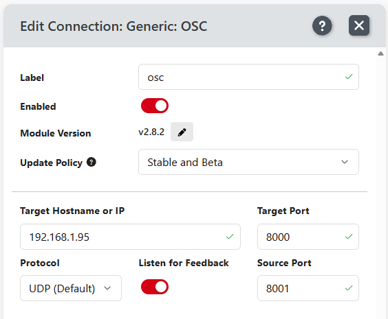
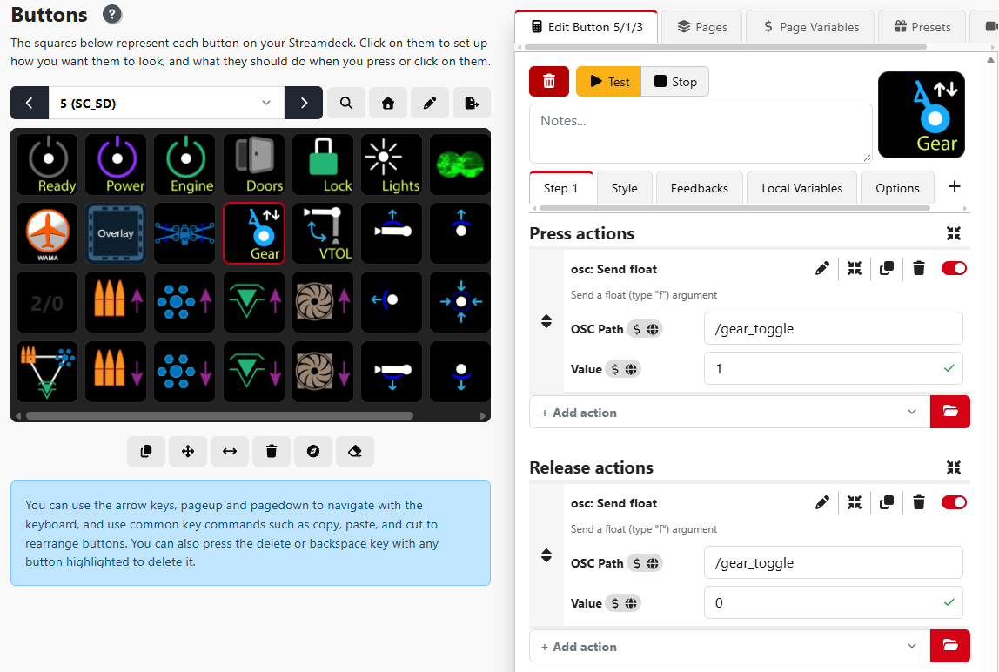

# Bitfocus Companion Setup Guide

Use an Elgato Stream Deck button in Bitfocus Companion to trigger a GremlinEx (GEX) mapping. Companion reads the key press and release, sends them over UDP, and the GEX **OSC** device runs the mapping for the received address. The example below uses the **Gear** button on the saved Star Citizen **SC_SD** page and the matching **SC Ex** GEX profile.

## Connect the Stream Deck to Companion

1. Connect the Stream Deck over USB and launch Companion. Open its web admin from the Companion launcher. The example installation uses `http://127.0.0.1:8010`.
2. For direct USB control, exit the Elgato Stream Deck app. In Companion, open **Surfaces**, enable the Elgato Stream Deck surface integration if needed, and use **Rescan USB** if your deck is missing. [Companion Surfaces](https://companion.free/user-guide/v5.1/config/surfaces/)
3. In the deck’s surface settings, turn off **Use Last Page At Startup** and select the desired **Startup Page**. Choose **SC_SD** if you are using the example layout. If the Elgato app needs to stay open, install the Bitfocus Companion plugin from the Elgato store, enable its surface integration in Companion, and assign its button actions to physical keys in the Elgato app. [Companion setup for Elgato](https://companion.free/user-guide/v5.1/getting-started/before-you-open/#preparation)

## Connect Companion to the GEX OSC listener

1. In GEX, open **Options → Modules**, enable **OSC**, and restart GEX if you changed the setting.
2. Open **Options → OSC/MIDI**. Check **Enable OSC**, then note the **GremlinEx IP** and **Input port**. The example uses `192.168.1.95` and UDP port `8000`. Use the address displayed on your machine.
3. In Companion, open **Connections**, add **Generic: OSC**, and name the connection `osc`. Select **UDP** and enter the GEX listener values in **Target Hostname or IP** and **Target Port**. If both apps run on the same PC, match the address GEX actually listens on. Use `127.0.0.1` only if GEX is listening on loopback. Save the connection. [Bitfocus Generic OSC connection](https://bitfocus.io/connections/generic-osc)

The example also receives return messages on Companion UDP port `8001`. To reproduce that part of the setup, enable **Listen for Feedback** and set **Source Port** to `8001`. Companion’s web admin uses a separate TCP port.

## Set up the Gear button

1. In Companion, open **Buttons** and choose **SC_SD**. The saved gear button is at row `1`, column `3` in Companion’s zero-based grid. To make your own, select an empty position, create a **Regular button**, and label it **Gear**.
2. Under **Press actions**, add **Send float** from the `osc` connection. Set the OSC path to `/gear_toggle` and the value to `1.0`.
3. Under **Release actions**, add a second **Send float** action with the same path and value `0.0`. Each physical press and release now sends one message. [Companion button actions](https://companion.free/user-guide/v5.1/config/buttons/creating/actions/)

| Stream Deck event | OSC path | Float value |
| --- | --- | --- |
| Press | `/gear_toggle` | `1.0` |
| Release | `/gear_toggle` | `0.0` |

## Map the OSC input in GEX

1. With the profile stopped, select **Default** mode and open the **OSC** tab. Use the existing `/gear_toggle` input in SC Ex. To recreate it, click **Add** and enter `/gear_toggle` in **Cmd**. You can also click **Listen for input** and press the Stream Deck key to capture the message.
2. Choose **Message only** and **Button**, and use the first argument. Leave **Trigger on message** off so Companion’s `0.0` releases the input.
3. Add a **Basic** container and **Map to Keyboard/Mouse Ex**. Set the key to **N**, choose **Pulse** with a **125 ms** duration, and enable execution on press only. If you changed the Star Citizen landing gear binding, use your own key or chord. [Map to Keyboard/Mouse Ex User Guide](../actions/keyboard_ex_user_guide.md)
4. Save and activate the profile. With Star Citizen focused, press and release the Stream Deck key. The press sends a single key pulse and the release resets the OSC input for the next press.

## Check where a signal stops

| What you see | What to check |
| --- | --- |
| The physical key is blank or shows a different action | Check that the deck appears as a Companion surface and is displaying the page with your Gear button. Open Companion’s **Emulator** to test the same page without the hardware. |
| GEX’s **Listen for input** captures nothing | Check Companion’s target IP, UDP port, and `osc` connection. Compare them with the address shown in the GEX listener. For a second computer, allow inbound UDP on the GEX machine’s private network. |
| The button presses but never releases | Check that **Release actions** sends float `0.0` on the same address as the press. |
| GEX sees both values but the game does nothing | Check that the profile is active in the mapped mode and that the key or chord matches the in-game binding. |

For faders, additional SC Ex mappings, and the `/switch_sc` message sent back to Companion on profile start, see the [OSC Device User Guide](osc_device_user_guide.md#bitfocus-companion-example).
