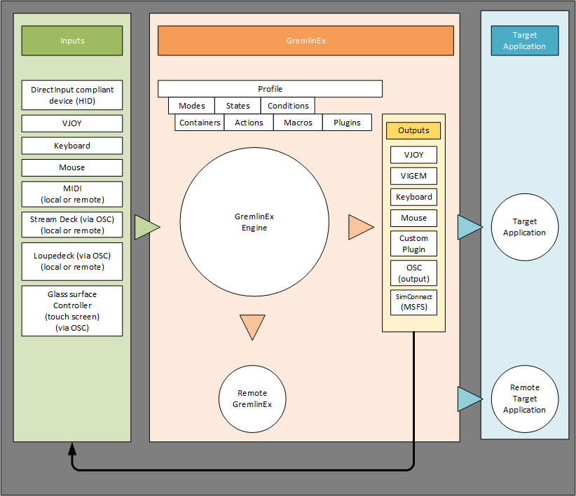

# Introduction

(this documentation is a work in progress as new features and updates are made for the m77 version currently in testing).

## What is GremlinEx (GEX)?

GremlinEx also known as GEX is a universal game/simpit controller integrator: it allows you to take input from various hardware or network devices, process or combine that input, and send the computed output to a simulator, game or application.

### Audience

The audience for GremlinEx (GEX) is anyone looking to easily integrate and unify multiple hardware input devices from joysticks to control panels and map it to a game without having to use proprietary vendor software.

GremlinEx is simple to use for simple mapping scenarios, yet can also perform very complex mapping tasks with its more advanced options.

GEX includes a rich set of tools for the transformations, manipulation, processing and routing of inputs.  GEX supports anything from custom joystick curve editing to conditional output, execution.  It supports profile modes and a dynamic state machine to dynamically control the branching and execution of mappings at runtime.  GremlinEx can also remote control other GEX instances on the network, playback audio, supports dynamic text to speech, voice recognition, axis merging and axis splitting and scaling, curving and calibration.

GEX is based on years of experience with various game mapping software and specific challenges related to supporting multiple simulation games, each with their own approach, and wanting to provide a unified experience that does all the mapping in one unified application.

A more detailed look at features supported by GremlinEx can be found in the [overview section](overview.md) of the documentation.

### Supported inputs

- Joysticks axis (linear)
- Joystick buttons (momentary)
- Joystick hats (momentary, 8 position + center)
- Throttles axis and buttons
- Hardware panels (in HID controller mode)
- Keyboards with advanced multi-key latching, media keys, and extended key support such as F13 to F24.
- Mouse (movement, buttons, horizontal and vertical wheel)
- Generic HID game controllers
- Custom simpit Arduino or Rasberry Pi (in HID controller mode)
- OSC (Open Sound Control) devices such as audio mixers, touch surfaces with axis and button parameter support
- MIDI devices (via USB interface) (linear, momentary and CC/channel support)
- Touch Screen Panels
- Audio Visual equipment and stage controllers including Streamdeck and LoupeDeck (via Bitfocus Companion and OSC)
- GEX network clients
- Voice inputs (voice recognition) [experimental] with supression mode (PTT) support to disable on the fly.
- Overlay touch input [experimental]
- Overlay web input [experimental] for touch support on non Windows devices (phones, tablets)
- Streamdeck input (native and via BitFocus Companion/OSC)

### Supported outputs

- Virtual joystick output via VJOY for axes, buttons and hats (up to 16 devices with up to 8 axis, 128 buttons and four 8-way hats)
- Keyboard
- Mouse
- OSC protocol devices for output control
- Ability to execute a process
- AI enabled advanced text to speech with high quality voices
- Advanced screen Overlays [experimental] - design and superimpose widgets that react to input on any monitor
- Advanced text to speech (TTS) to convert text
- Multi-stream audio playback
- External process execution
- Output to other GEX network clients for remote control including full KVM exclusive mode
- Virtual gamepad controller
- Microsoft SimConnect API for Flight Simulator 2024 output including support for custom API expressions and in-sim bridge WASM module

### Supported processing includes

- multi-step axis merging (combining) from same or different device, with scale, add, substract, center and trim modes
- advanced axis processing including multiple custom triggler points on axis, directional triggers, range entry/exit/in-range logic, range suppression, output re-scaling based on range
- State machine logic including boolean expressions, exclusive and grouping behaviors
- Grouping of actions in profile modes that can be nested
- Multi-latch of keyboard inputs
- Two input encoder inputs (multi button or multi key) including acceleration and PID (setpoint) output models
- Axis to button with custom stepped and PID behaviors
- Button to axis with custom steps
- Macro execution
- Advanced sequence execution (any output) including random modes
- Hold, pulse, press, release, toggle functionality for actions
- Convenience containers for easier and faster mapping of common processing tasks (repeater, button press/release)
- Timed containers for single click, double click, short press and long press
- Advanced keyboard mapper with multi-latch of any key beyond the usual modifiers
- Remote control of other GEX clients on the local network
- Custom Python plugin API to add custom functionality not built in

### GEX performance

- targets high speed runtime processing in the millisecond range (sub 50 millisecond is the target with most being under 10 milliseconds in benchmarks)
- low CPU overhead for most modes (varies with profile complexity)
- built in Python but leverages native C++ libraries for fast execution
- Note that complex profiles and displaying hundreds of inputs concurrently may increase CPU and memory usage by a significant amount.  To this end, GEX offers multiple UI filters to reduce the visible input count.   This usage is for design time only and does not typically carry over into the execution phase, although it is recommend once the profile is designed to limit the number of inputs displayed in the UI to reduce the overall footprint, and to disable modules that you do not use so they don't consume resources just by being loaded.

### What can you do with GEX?

- GEX is hardware agnostic and lets you combine inputs from different controllers and unify them with a single profile, removing the need to program these devices separately using vendor specific software.
- GEX provides advanced processing of linear (axis) and momentary (button/key) inputs and lets you combine them for specific behaviors
- Rich set of containers and actions to simplify typical mapping tasks, each with basic and advanced functions.  GEX can thus handle simple mapping tasks or very advanced layered/branching for simulation/simpit applications.
- Create a graphical game overlay that responds and displays your inputs on any game or application, for streaming, or instructional purposes or just visual feedback.
- Trigger commands using your own voice using the voice recognition module (experimental)
- Supplement actions with audio cues through the abilty to play multiple sounds at once, including text to speech
- Design a state machine that branches profile execution extremely efficiently
- Use hardware data or or states as input conditions to determine if an action should execute or not
- Perform "setup" actions on profile start, or mode entry, to set buttons, axes or press/release keys just by start/stop or changing modes.
- Works with any game/application that supports joysticks, keyboard or mouse input
- Ability to send axis/buttons/keys to remote GEX clients on the local network with low latency to share hardware devices - this can be exclusive or concurrent
- When used with HID Hide, lets your game or simulator only see the GEX outputs, so it does not get confused with your real hardware.
- When used with Bitfocus Companion, lets you incorporate non tradditional control surfaces with buttons and faders into your simpit, including touch-screen (via OSC)
- The new web overlay lets you use a networked phone or tablet to design and send control inputs to GEX that can then send it to your game/simulator.
- The plugin architecture lets you use simulator APIs for two way communication.  GEX includes MSFS support built-in.

### Supported platforms

- GEX is currently 64 bit Windows only due to underlying dependencies.
- Non Windows support is offered via the web overlay module (experimental) so that phones and tablets can be used as touch screen inputs.
- GEX is built on Python 3.14.x, QT 6.x for the UI components and open source underlying libraries.  GEX does not include any non-open source components.  AI services are using free, publicly accessible, APIs.

### Requirements

- Windows 11 x64
- Python 3.14 and any redistributable libraries are included in the base package and do not need to be installed. Some optional modules may download automatically if not installed from their respective open source projects.
- VJOY is required (other virtual controllers are being considered such as HIDMaestro)
- 1Gb of disk space and 16Gb memory.
- A multi-core processor as GEX is heavily threaded.

### Supported protocols

- OSC (Open Sound Control) protocol devices
- MIDI protocol for older MIDI controllers (local or networked via MIDI/OX)
- UDP (for local network communication)

### Recommended setup

- one or more USB connected hardware joystick / panel / throttle that looks to Windows as an HID game controller
- VJOY devices configured (two or three recommended as most titles recognize the first three joysticks - this gives you more axes, hats and buttons you can program).

### Example of hardware tested with GEX

- Raberry Pi custom HID controller
- Derek Spears Design hardware panels (racing)
- Wooting HE/HE2 keyboard (in joystick and regular modes)
- Steelseries, HyperX and Logitech keyboards
- Azeron
- Octavi IFR1
- Touch/OSC by Hexler (payware)
- OSC/Pilot (payware)
- Open Stage Control OSC surface (open source)
- Arturia and Korg-mini MIDI controllers
- Corsair Elgato StreamDeck and LoupeDeck (various models - button, encoder/touch fader modes, one and two way communication)
- Logitech and Razor gaming mouse
- Thrusmaster, Virpil, VPC, MFG, Logitech and Honeycomb controllers (throttles, pedals, panels, joysticks, yokes) - should work with Moza and WingWing as well
- Rotary USB encoders (keyboard output)
- OBS (Open Broadcaster Software) for streaming with the GEX overlay module
- Windows touch screen functionality via Open Stage Control (network device) for glass surface game control

### Example of tested applications with GEX

- Cloud Imperium Games - Star Citizen
- Eagle Dynamics DCS - Digital Combat Simulator
- Microsoft Flight Simulator 2024 (direct via API)
- Egosoft X4 Foundations
- Blender 3D
- OBS (Open Broadcaster Software)

## What's new in m77?

GEX m77 is the current iteration of GremlinEx in testing/development and incorporates:

- Python 3.14.x support (without JIT compiler support as JIT is, for the moment, incompatible with QT)
- bug fixes from m76
- feature polish from m76 and a more consistent user interface
- new overlay module for dynamic graphical widgets used as an overlay to a game screen
- new Streamdeck bridge module (allows communication without Bitfocus or OSC)
- new web module (allows interaction with GEX from any networked web browser such as a phone or tablet)
- new audio engine with concurrent audio stream playback, fade in/out processing, pitch correct playback speed controls, volume controls
- new AI text to speech for high quality TTS audio cues (up to 300 voices) (runs once to generate, caches generated audio files locally)
- new voice recognition module (GEX will listen to voice commands and trigger actions) based on OpenAI's open source Whisper (runs local)
- new state behaviors, including exclusive mode, grouping and attribute based triggering in map to state action
- new PID (setpoint) controller mode for stepped axis (button to axis or encoder) - allows for dynamic time and deviation based response curve to smooth axis output to a specific value
- new rotary encoder input support with acceleration support (these devices pulse in one direction or the other for axis output)
- updated user interface and streamlined look and feel
- EMA (exponential moving average) filter for chatty or noisy axis input filtering (this is aimed at older potentiometer based controllers or very chatty devices like Wooting or Azeron that spam the axis input queues)
- more polished and responsive user interface with numerous improvements to memory management and workarounds for native issues between QT and Python
- new custom color theme in addition to the existing dark/light modes
- reworked sequence container for advanced macro-type functionality
- reworked legacy macro execution engine to reduce latency
- improved performance of input viewer repeaters
- optimized custom UI components
- reworked condition shortcut branching in the execution engine to increase performance and eliminate redundant evaluations
- optimized API flows to reduce overhead and further reduce TTO (time to output) on processed triggers
- reworked DINPUT input queues and event distribution, more use of direct callbacks and teardowns to optimize response time and reduce Python overhead/leverage caching (prior event handling model could choke on heavy inputs).
- focus on quality of life improvements with container/action and input manipulation in particular

## How can I support the project?

The project is a labor of love and started as "I really want to be able to do [missing feature here] and can't find a way to do this".  The project has evolved in the last few years to take significant time and resources to support and develop.

Please consider supporting the project by making a secure donation, either one time or recurring, via the sponsor link on [the home project on Github](https://github.com/muchimi/JoystickGremlinEx).

This project is open source.  It has as of this writing, more than 133,000 of lines of code (almost 200,000 if you include comments) - it is a large project.  Donations help with the purchase of hardware, maintaining computing resources for testing and development platform purposes.  Donations make more time available to research, develop features and support the project on an on-going basis.  Thanks to your help, the project has already seen hundreds of updates, many of them daily.  It has seen the implementation of nearly all requested features, many of which are not available in other similar tools.  It has a [rich set of features](overview.md#key-features-what-can-gremlinex-do), many of them not found in payware tools.   It is your support and shared passion for this hobby that makes GremlinEx, and its continuing support, possible.

Thank you for considering supporting the project if you have not already, and thank you to those of you who have already supported.

Every bit helps!

## Project Home on Github

The project's [home is on GitHub](https://github.com/muchimi/JoystickGremlinEx) from where you can download the latest releases and view patch notes.

## Support and chat

The project has a dedicated [Discord server](https://discord.com/channels/1279461873317707827) where you can lookup solutions to typical mapping questions, view how-to guides and setup screenshots, ask questions and report any issues.  You can also report issues on GitHub if you wish.

## General Architecture

GremlinEx takes inputs from multiple sources, local and network, performs the transformations and mappings specififed in the profile based on the current profile options, container and action configurations, and sends the output as required.

There should be no expectation that a single input always results in a single output. A single input can produce multiple outputs, and multiple inputs can provide a single output.  It's also possible that no output is produced if the input(s) should be ignored based on the particular context.

## Differences with Joystick Gremlin

GremlinEx started as a fork of the excellent Joystick Gremlin by Lionel Ott years ago.  The initial goal of was to port that code to 64 bit and a more recent version of Python.  This quickly grew into updating underlying libraries including QT and others, and resolving incompatibilities.  Then came new actions and containers, a completely new execution engine and underlying data structures, etc...

Fast forward to today: GremlinEx (GEX) at this point is not Joystick Gremlin **nor a new version of Joystick Gremlin**.  Very little remains from the original fork except for the concept.  GEX has been re-architected, is well over 90% new code, and converted, while keeping with the spirit of the original, to a new framework which extends to how it works internally.   While common in origin, GEX is very significantly different internally with a different run engine, heavy use of multi-threading, new, deprecated or significantly reworked actions and containers.  GEX also has core new functionality including networking, voice and a completely new API.

What it retains is the general ability to convert older profiles, provided the containers and actions still exist and can be converted, which should be the case.  However in many cases, the new features suplant these older constructs.  For example, you would not use merge axis or separate curve actions anymore, you'd find all of this directly baked in the [map to vjoy action](actions/map_to_vjoy_user_guide.md).  You would not use axis to buttons, you'd use the new [gated axis action](action/gated_axis_user_guide.md).

Available reworked and new [containers are listed here](containers.md#containers) and available mapping [actions are found here](actions.md#actions).

GremlinEx is squarely focused on runtime performance, with most mappings aiming for millisecond processing time, and has many UI features to reduce the UI complexity to help with performance at design time.  To this end, the idea is you design the profile once, where you spend most of the time planning, designing and leveraging new features such as **states** intead of **modes** for condition and structure.

GEX is heavily networked now: it supports remote control of multiple clients and can listen to protocols like OSC.  It supports network protocols to accept inputs from other devices on the network, and send data to other devices on the network for two-way communication/updates.

GremlinEx even has a KVM (keyboard video mouse) mode to take over a remote GEX client for game control purposes as if the controls were connected locally to the remote machine.

While most Joystick Gremlin profiles should load as-is, some may not depending on the version of the profile and features used, especially if the features were deprecated in GremlinEx and replaced.  This said, simpler profiles `should` work `as-is`.  A lot of care was applied to ensuring older profiles can load "as is" with the necessary conversions happening automatically - however this only goes so far.

Also note that once a profile has been touched by GremlinEx, it may not work at all with any other prior version, including Joystick Gremlin because of changes to the profile file.

GremlinEx also has several UI (user interface) enhancements aimed at improving the understanding of "what is my hardware doing now", for example, visual repeaters on buttons and axes, and automatic input switching for that time when you don't remember what button is what and you need to go to that input fast.

GremlinEx lets you re-order your devices internally so the ones most often used can show up first in the user interface.

GremlinEx is Windows theme aware, so has a dark mode.

GremlinEx has a new sound processing engine, and features to play back audio at different speeds while maintaining the pitch.

GremlinEx has a new API that makes it easier for custom plugins to be written and interface with inputs and outputs.

## Installation

GremlinEx comes as a compressed zip file in the [release section of GitHub](https://github.com/muchimi/JoystickGremlinEx/releases) that contains all you need including required libraries.

The contents of the zip file should be extracted to a folder that is not a protected system folder such as "Program Files" or "Windows".

The recommendation is to install GremlinEx in its own folder, like "GremlinEx" and if you will use multiple versions, it's recommended you also name the folder after the version.  This is automatic if you extract the zip File using tools like 7Zip or Nanazip as the folder will be the same name as the zip file.  This enables you to have multiple versions installed.

The master repository can be found here on GitHub: [https://github.com/muchimi/JoystickGremlinEx
](https://github.com/muchimi/JoystickGremlinEx).

### Test versions

GremlinEx uses an open development philosphy.  As such, test releases are frequently available that introduce not only fixes but desired features as well.  Some of the versions are more robust than others, however test versions are more likely to have issues, especially with new features.

To this end, GremlinEx offers in the configuration an option to "Version" profile folders so that configurations and profiles are safe from mishaps, such as a new profile version making it incompatible with a prior version of GremlinEx.

It is a best practice regardless ot make a copy of the data folder (default is %USERPROFILE%\Joystick Gremlin Ex) to safeguard any files and configurations, just in case.

### Required additional tools

GremlinEx works with a number of tools to function as a device integrator, such as VJOY.   Some tools are mandatory (VJOY), others are not (VIGEM, Bitfocus) but recommended.

Please see the [resources section](resources.md) for a list of required and optional tools.

### Optional WASM module

The Microsoft Flight Simulator SimConnect module in GremlinEx requires the installation of the WASM module in the MSFS community folder.  This module is what provides GremlinEx with the ability to execute calculator code in MSFS and thus read/write variables and simulator controls not otherwise exposed by the SimConnect SDK (as of this writing).

### Running from source

While GremlinEx releases are provided as self-contained Python packages, you can run GremlinEx directly from source code, especially if you would like to contribute or just see how GremlinEx does what it does.  The recommended environment is [Visual Studio Code](https://code.visualstudio.com/).  When running in this mode, it is up to you to setup the environment and pre-requisites manually.  The GremlinEx project on GitHub includes a Python requirements file listing dependencies.  This is an advanced topic and requires a strong familiarity with Python development, working with Python and Python libraries, installing and configuring these environments, interfacing with C++, using the QT graphical environment, and working with low level hardware and network protocols. Also of note is the dependencies will vary with new releases as the project matures.

### OSC configuration

OSC (Open Sound Control) is a very important feature support in GremlinEx that allows it to communicate hardware panels like Elgato Streamdeck via [Bitfocus Companion](https://bitfocus.io/companion).  The feature also provides support for glass surfaces (touch screens) via tools like [Open Stage Control](https://openstagecontrol.ammd.net/).  While supported in the box, it does require some ports to be specified.

For Elgato Stream Deck specifically, GremlinEx also supports a direct [Stream Deck plugin bridge](streamdeck.md) that keeps Stream Deck software running (no Companion required for those keys).

Joystick axes and buttons can be drawn on a chromakey window for OBS, or as an on-screen HUD, without Touch OSC. See the [overlay](obs_overlay.md) guide.

Please see the [OSC configuration section](usage.md#osc-device-open-sound-control) for OSC specific setup to enable this feature.

### Virus False positives

Unfortunately, some older anti-virus and anti-malware programs may flag GremlinEx (and any Python packaged applications) incorrectly, known as a false-positive.  See more on the topic and options in [this section of the documentation](usage.md#antivirus-false-positives).  It should be noted that most malware and anti-virus tools correctly handle the false-positive.

## Running GremlinEx for the first time

The first time you run GremlinEx, as it is written (mostly) in Python, the Python environment will most likely be running first a first run optimization and cache creation process.  This happens for every new version of GremlinEx, but only the first time a module is used/loaded.  This process is automatic and part of the normal Python environment.  You may thus experience an increase in load times and decrease in performance when first running a new version, especially at design time.  This however should not persist on a restart once the caches are created and the optimization done by the Python environment has completed.  This is less noticeable on systems with very fast storage solutions as Python creates a number of files during this process, however it can still be noticeable.

It is thus recommended to run the software once, and then restart.

## UAC (user access control)

Windows UAC may prevent GremlinEx from starting with Windows (if the option is selected) unless the process is given higher permissions.  Typically this will manifest itself as a load error, DLL not found error or some other I/O error, even if the program runs fine when started normally.  This is not a GremlinEx issue but a UAC security issue.

## Resources and help

&nbsp;Please join our  [GremlinEx Discord](https://discord.gg/pNadcReth9) server!

## History

GremlinEx is based on a fork from the 2019 [Joystick Gremlin by Whitemagic](https://whitemagic.github.io/JoystickGremlin/).  GremlinEx builds on that excellent software and its concepts, and incorporates notable modifications and enhancements:

- x64 bit support and current Python environments/libraries
- remote control of GremlinEx instances
- Built-in state machine with user defined states, including support for boolean state expressions and state triggered mappings
- Built-in support for the [OSC](https://en.wikipedia.org/wiki/Open_Sound_Control) protocol and [MIDI](https://en.wikipedia.org/wiki/MIDI) devices.
- Streamdeck, Loupedeck and other panel two way control.  To simplify and greatly enhance capabilities, highly recommended via [Bitfocus Companion](https://bitfocus.io/companion)) to simplify the setup with GremlinEx
- Support for custom glass surface controller support (touch screen use-case)
- Built in-support for Microsoft Flight Simulator 2020 and 2024 control via the SimConnect SDK including a custom WASM module for calculator expressions and access to custom sim variables
- Advanced containers and actions included.
- High performance runtime execution graph engine (starting with m73)
- Advanced latched keyboard and mouse inputs
- Support for extended keys including F13 to F24 and media keys
- Selectable voice and playback speed for text to speech prompts
- Modern user interface with dark UI theme support
- [Overlay designer](obs_overlay.md) for chromakey or on-screen joystick visualization without Touch OSC

While GremlinEx is based on Joystick Gremlin, it's important to note they are not the same software, certainly not internally, but also from the standpoint of behaviors.  GremlinEx is heavily event based, has a completely different execution engine.  While legacy profiles may load in GremlinEx, complete compatibility is not assured.

GremlinEx makes an attempt to keep with the philosophy and concepts of the original project as much as possible, and I am grateful to WhiteMagic and his excellent work on Joystick Gremlin and for the inspiration. Joystick Gremlin remains one of the best mapping utilities I have ever seen or used in decades of simpit simulation.  The architecture is elegant and served as a launchpad for GremlinEx.

GremlinEx is in active development and thus may include bugs and issues refered to as dragons.  Rather than releasing new features and fixes sporadically, I have adopted an open development model where pre-releases are posted to the dev branch for you to use as the features and fixes are implemented.  Some are more bleeding edge than others.

I am a firm believer that open development outweighs the drawbacks, it encourages feedback and input and participation from the community. I appreciate the patience as not everything will work in every pre-release patch as expected, that is part of the process.

