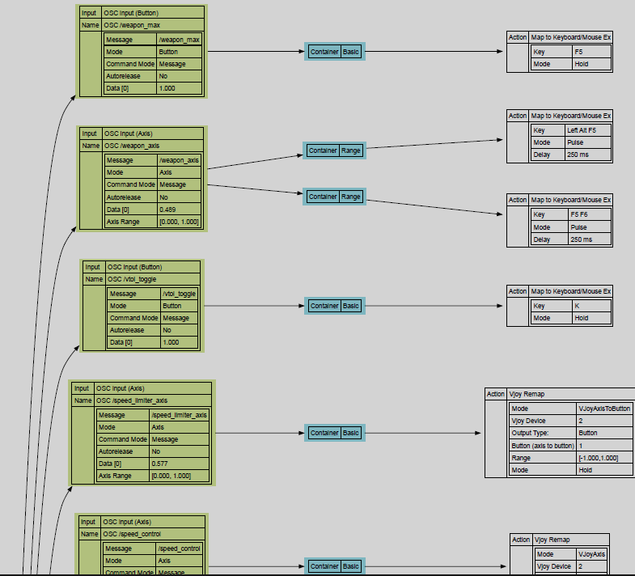
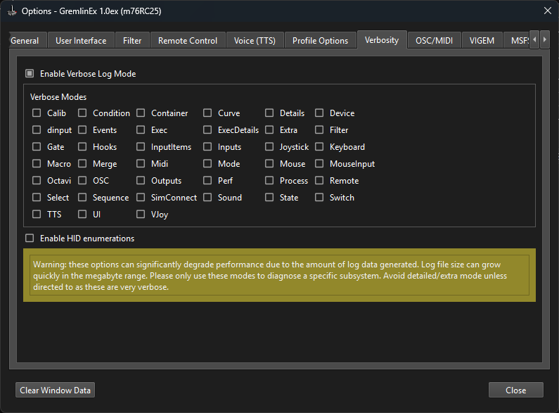

# GremlinEx Overview

GremlinEx (GEX) combines inputs from joysticks, gamepads, keyboards, mice, hardware panels, and networked controls into mappings for games and other applications. Outputs include vJoy, virtual gamepads, keyboard and mouse commands, OSC messages, simulator commands, and audio.

This overview covers the **m77 development series**, including its Overlay, Stream Deck, Voice, and AFCS modules. Enable the modules you need in **Options → Modules**; availability can depend on the build and installed dependencies.

The integration piece comes from the ability to combine inputs together into a logical output via a set of filters and transformations, and output this to applications running on the same system.

The project's [home is on GitHub](https://github.com/muchimi/JoystickGremlinEx) from where you can download the latest releases and view patch notes.

The project has a dedicated [Discord server](https://discord.com/channels/1279461873317707827) where you can lookup solutions to typical mapping questions, how-to, ask questions and report any issues.

## Key Features: What can GremlinEx do?

Choose the inputs, outputs, and optional modules needed by your profile.

### Mapping and transforms

GremlinEx (GEX) takes input such physical (hardware) USB connected joysticks, gamepads, keyboard, mouse, and other specialized input devices like state and OSC network messages, and lets you apply a mapping, also known as a transform, to each input. GEX also understands network inputs that come from other devices on the network via the OSC protocol.  GEX supports mapping of buttons, axes, sliders, hats, or more complex inputs such as latched keystrokes (one or more keypress combination), and other input such as MIDI or OSC input (described below).  GEX can also remote control other GEX clients on the network, including output of axis, button, keyboard and mouse, as well as two-way controls of hardware panels and glass surfaces via the OSC protocol.

The mapping process can have logic applied to it, such as conditions, so that the mapping can be conditional on a specific context being true.  This can be "is this button also pressed", "is this axis value in this range", "are these keys also pressed", "is this state off", all in various combinations.  Conditions work across all inputs so one input can be used to manage the mapping of another device.

Axis (linear) input can be curved and calibrated.  In fact, multiple curves can be applied, and the curves can be conditional as well.  For example, you can invert an axis but only if a condition is true, and when the condition is false, the axis will not be inverted.

GremlinEx handles multiple inputs and outputs concurrently.  Routing can change mappings based on conditions, modes and states, and this can be changed dynamically on the fly.

GEX supports using vJoy as an input and output in the same profile. This lets a virtual device feed another mapping, including values written by a different application. Keep the routing directed so an output does not repeatedly trigger its own input. Use ordinary states and expression states for internal On/Off logic when no virtual joystick output is needed.

### Agreggation of multiple devices

GremlinEx is designed to simplify mapping for a game or application so that the application has much fewer devices to map.  The first major benefit is to reduce the number of input devices, as many titles only "see" a few joysticks, and if you have a simpit, you could have left, right, center controllers all connected at the same time, and you may use some of them, or all of them, to map to the same input.  This can be very difficult to do in some games.

GremlinEx is vendor agnostic so any mapping software that is proprietary to a particular manufacturer does not need to be used in most cases.  GremlinEx will use the raw device capabilities as seen by Windows, so as long as the device shows in Windows without software as a game controller, GremlinEx can create mappings for it.

GremlinEx can combine inputs from multiple types of devices:  GremlinEx lets you merge data from different devices (such as axes on two or more controllers), or use controller button and axis values as conditions to decide if other output should go through or not.

### Dynamic routing

Because GremlinEx has conditions and modes and states, you can "route" the input to different outputs, as well as modify the output in a dynamic way. You can take a single input and map it to different outputs depending on what you need.  So a toe brake on a rudder can become an accelerator or brake pedal for a vehicle on the ground, or an up/down strafe if you are in a spaceship, or plain toe brakes if you are in an airplane with differential left and right brakes.   You can have a button that is normally your primary trigger button control different weapon groups depending on the mode GremlinEx is in.  An axis can inverted dynamically, or different response curves applied to control, for example sensitivity.

### VJoy output

The [Map to vJoy action](actions/map_to_vjoy_user_guide.md) maps controls to virtual axes, buttons, and hats. It includes output curves, scaling, axis merging, axis-to-button ranges, pulses, and toggles. A game can bind these virtual outputs while HidHide keeps the original hardware out of its input list.

m77 also expands button-to-axis control with presets, accelerated encoder input, and smooth PID transitions. These controls can adjust trim, flap positions, or a speed limiter without requiring another physical axis.

### VJoy as input

GremlinEx supports concurrently VJoy as an output device, as well as VJoy as an input device in the same profile.  When a VJoy device is configured as an input, it will add a new VJoy device to the list of input devices that can be mapped to in GremlinEx. When the VJoy button, hat or axis is set, either by another GremlinEx mapping, or a third party application, the input will trigger and GremlinEx will generate output based on the mappings for that input.

By design a mapping that triggers a VJoy output will also trigger that VJoy's input, if mapped and enabled, from the same profile.  This allows VJoy to be used as a bank of axes, hats and buttons for multiple parts of a profile to interact with.  A common scenario is to setup extra VJoy devices to increase the number of buttons, hats and axes GremlinEx can use to keep track of states without having to use custom plugins, or the GremlinEx state machine.

 It is generally discouraged to use the same VJOY device both as input and output in the same profile due to API limitations that can lead to race conditions, execution loops and deadlocks where VJOY devices could become "locked".  This is because the VJOY software is designed for it to be used per process as either input or output, not both (while possible as we work around this in GEX).  VJOY as input is meant to be used as a way to capture VJOY input data set from a different process (application).  It is supported in GEX, but has caveats that need to be considered when designing the profile to avoid these issues.

 VJOY input devices tend to create a significant number of inputs that GEX needs to track - up to 140 inputs per VJOY device used as input.  This can degrade user interface (UI) performance and increase the memory footprint at design time because of the need to visualize and track all these inputs.  Use the input filtering option available as of m76T115 to reduce the number of inputs visible in VJOY devices to keep the input count to a reasonable level.  The impact level is based on hardware capabilities, and the total number of inputs managed by GEX.  It is usually not an issue until you start getting into 400 to 500 inputs GEX has to track at the same time at edit time.  This does not impact runtime performance at all.  If you start noticing edit time performance degradation, it is likely due to the number of inputs and filtering should be used to keep that to a reasonable level.

### VJoy manual control

GremlinEx's Input Viewer can manually set vJoy buttons, hats, and axes to help design and test mappings. The m77 viewer also offers **Select Used** to select inputs and outputs referenced by the current profile. Its state display supports category and attribute filters, including saved state-filter selections.

### HIDMaestro development

m77 includes initial work on a Maestro Bridge and HIDMaestro virtual-controller support through the same mapping actions used for vJoy. **The current version of m77 disable this feature** as it is still under devleopment and testing.  It is not a replacement for the released vJoy setup at this stage; check the release notes for the build you install before planning to use Maestro.

### In-game mapper augmentation

GremlinEx can achieve very complex mappings that are not supported by a game.  It can take complicated inputs (such as from multiple controllers) and map it to something the game does support, and the game does not need to be aware of these inputs, as it will not see them.  The game will only see a supported command.

For example, you can combine inputs such as a keyboard key in combination with a joystick button and map that to a unique function in the game, even if the buit-in game mapper does not support these kinds of cross-hardware combinations.

### Easy mapping to game defaults

Certain titles have less than ideal mappings, for example, not supporting DirectInput joysticks but having support for a console game controller.   GremlinEx can bridge this gap by producing output the game expects, even if the game doesn't support specific inputs that GremlinEx supports.

It is generally recommended to use GremlinEx to map to default settings in a game, which avoids having to change mappings in the game itself.  This can greatly simplify game mapping for simulators in particular.

### Input and output from/to glass surface panels (touchscreens)

GremlinEx exchanges OSC messages with external touchscreen surfaces and panels, including button triggers and linear controls such as sliders or XY pads. m77 also provides built-in Overlay controls and a direct Stream Deck plugin bridge, giving these integrations their own designers and mappings.

For a joystick visualization overlay in OBS (chromakey window capture) or as an on-screen HUD, see the [overlay designer](obs_overlay.md).

### Overlays and browser-based panels

The m77 **Overlay** module adds a graphical designer for live input displays and interactive controls. A profile can contain several overlay pages, each with its own widgets and live window. Bind widgets to physical inputs, vJoy outputs, profile states, and keyboard or mouse activity, then use a chromakey window for OBS or a transparent on-screen HUD.

Interactive pages can supply buttons, hats, axes, switches, and state controls through mouse or touch input. The web overlay serves a panel to a browser on the local network, so a phone or tablet can display and operate controls while GremlinEx runs on the Windows host.

The designer includes images, shapes, groups, guides, variables, graphs, counters, and live application or Stream Deck displays. **Map to Overlay** controls page/group/widget visibility, interactive mode, and overlay variables from a mapping.

Optional OCR widgets scan selected screen regions and expose text-match rules as mappable inputs. A rule can trigger actions or contribute a detection label to an overlay variable. See the [Overlay guide](obs_overlay.md) for page setup, interactive controls, display bindings, and OCR.

### Networked devices support

GremlinEx has a built-in capabilityu to use controllers attached to one computer to control another and deliver the output to a game over the local network.

### Direct support for Microsoft Flight Simulator

GremlinEx has built-in support to directly control Microsoft Flight Simulator without using the internal MSFS mapper.  It uses the SimConnect interface to do this, and a custom WASM module to access internal variables not supported via SimConnect (as of this writing).

### Profiles

A profile stores the input mappings and logic for an application or control setup. GremlinEx can associate profiles with Windows processes and automatically select a profile when the associated process becomes active.

Mappings and state definitions are stored in XML. Designers such as Overlay also use a companion JSON file beside the profile. Keep the XML and companion files together when copying or sharing a setup. Audio files referenced by path and the generated-speech repository are separate from those profile files.

Profiles identify hardware by GUID rather than its order in Windows. A device missing on the current computer can appear disconnected while its mappings remain available for remapping or copying. Check device references when moving profiles between computers or after hardware/firmware changes.

### Joystick and game controller integration

GremlinEx accepts inputs from any number of HID game devices and maps this input, apply a number of transformations and filters, and creates output virtual joystick (Vjoy) device, a virtual gamepad controller (via Vigem), keyboard and mouse output, OSC network messages and others.  GremlinEx supports input from Arduino and Rasberry Pi when those devices are in HID "game controller" mode.

GremlinEx supports HID devices that report as game devices, and the supported inputs for each includes linear input (axis), momentary input (button) and four or eight way hats.  HID devices under Windows are limited to 8 axes, 128 buttons and four hats per device.

GremlinEx also has a loopback mode where VJOY devices can be used as inputs.  In this mode, GremlinEx will not be able to map outputs to the same input as that would create a loop.  This feature is intended for other software that also uses VJOY to provide input to GremlinEx.

### HIDHide support

GremlinEx is designed to function with [HIDHide](resources.md#hidhide).  HID Hide enables "hiding" of HID inputs that could conflict in a game with the mapping done by GremlinEx when detecting inputs. Many games also only support a finite number of HID devices, and many cannot handle more than three.

HIDHide solves both these problems: the idea is to "hide" the raw hardware inputs used by GremlinEx from the game so they are only visible to GremlinEx.  This way, the game only sees the GremlinEx output devices (VJOY and VIGEM) when doing the in-game mapping, and does not see the devices actually connected to the machine.  There are thus no conflicts and no confusion with the in-game mapper as to "which device am I reading from".

It is essential to have the GremlinEx executable white listed in HIDHide so it sees the raw hardware devices.

### Axis curves

GremlinEx can apply linear, cubic and bezier curves to an axis (linear) input to modify the input response, the output response, and both concurrently.  Such curves are usually called response curves or sensitivity curves.  Multiple curves can be applied to the same input, for example, a curve on the input itself, and a curve on the outputs.  Curves applied to outputs are only applied to a particular mapping.  Curves can be manipulated, and GremlinEx supports presets, both built-in and custom user.

It generally is not appropriate to apply two response curves on the mapping side as that can lead to undesirable output values, so while it's possible, ensure the applied curves do not inadvertently produce undesirable data.

While curves can be applied as a standalone mapping, it is recommended to apply curves directly to the vjoy remap action.  One reason: this curve is applied to the merged axes.  Execution at runtime is also faster as it avoids a step.

Profile modes, states and condition let you control how and when curves are applied, so you can, for example, have two or three sensitivity settings for an axis output based on the state of input buttons on a hardware panel, or you can toggle them by pressing a button.

### Axis calibration

GremlinEx calibrates joystick axes by recording their endpoints and center, then normalizing the input. Calibration applies to the device across profiles. Use output curves and ranges for a particular mapping's response.

m77 adds an **EMA (exponential moving average) axis filter** to smooth noisy input and reduce redundant events from devices that send frequent axis updates. Filtering helps control input traffic; calibration defines the usable travel. Check both the displayed input and final output when adjusting a filter.

### Axis gating and splitting

GremlinEx supports several axis splitting tools, including the advanced Gated Axis that introduces the notion of gates (fixed points on an axis) and the ranges between them.  Gates and ranges have their own trigger points.  Gated axis is aware of when a gate is crossed, the direction the crossing happened, and if the current position is entering or exiting a range, outside a range, or within a range.

GremlinEx can trigger separate mappings (actions) when the input axis crosses a gate or is within a range.

Because each gate or range has its own separate triggers, it allows for very detailed and customized control of mappings at specific points, or within ranges of the axis or slider.

#### Gated Axis Examples

- to implement gates on an axis like on aircraft throttles, such as the F16, A10, Airbus throttle or a turboprop aircraft for flight simulation and helicopter collectives, and thrust reverse mapping.
- to trigger different output based on the direction of travel when the input crosses a particular point.
- to implement multiple response curves on the same axis by section.
- to split an axis into several non linear ranges, each with its own output curve, scale, direction, including no output/deadzones.
- to trigger outputs based on the direction of travel on the input, so a trigger passing through a point going up can be different from a trigger of the same point going down.
- to scale output within a range
- to setup deadzones or fixed value zones within an axis (no output or fixed output while in range)
- to support gated hardware or physical detents on input hardware that does not trigger inputs at these locations
- to implement virtual hardware detents if the hardware does not support physical detents

### Axis merging

The [Map to vJoy action](actions/map_to_vjoy_user_guide.md#merge-axes) combines two or more axes from the same or different controllers. Merge entries support arithmetic, minimum/maximum, scaling, and trim operations, with curves and output-range controls.

Use it to combine two toe brakes into one output, scale one axis with another, or add trim to a primary control. Live previews help check the individual sources and combined result. Modes, states, and conditions can select different mappings when needed.

### Button and encoder control of axes

Map to vJoy's button-to-axis controls offer **Velocity**, **Stepped**, **Stepped+PID**, **Encoder**, and **PID** modes. Velocity adjusts while held; Stepped selects preset positions; Stepped+PID moves smoothly between those presets. Encoder supports pulse-based adjustments and acceleration, while PID moves toward a target changed by momentary inputs.

m77 adds preset lists and step markers to the editor alongside startup-axis controls. These options suit trim, continuous flaps, throttle limits, and other controls that should move an axis without a dedicated physical axis. See the [button-to-axis instructions](actions/map_to_vjoy_user_guide.md#control-an-axis-with-two-inputs) for configuration.

### Visual axis processing with AFCS

The optional **AFCS** module provides a graphical axis-flow designer. **Map to AFCS** sends a physical axis into the graph as a named input. On the AFCS tab, connect inputs through merge and curve nodes to vJoy output nodes.

Use the graph when a connected visual layout makes a multi-axis setup easier to inspect. Enable AFCS in Options → Modules and configure the graph in the same profile as its input mappings.

### Direct Stream Deck integration

The m77 [Stream Deck bridge](streamdeck.md) connects the Elgato plugin to GremlinEx through a local WebSocket connection. Keep Elgato Stream Deck software running; Companion and OSC are not required for this connection.

Each connected deck gets a device tab. The designer provides virtual pages, separate pressed/released or state-driven appearances, icons and titles, and normal GremlinEx containers and actions on its controls. Stream Deck + includes dial controls. **Map to Stream Deck** changes pages, returns to a previous page, and supports timed auto-return.

The bridge also supports multiple decks and state-linked feedback. The [Stream Deck guide](streamdeck.md) covers plugin installation, enabling the bridge, page design, and mappings.

### Integrates with Elgato (R) Streamdeck, LoupeDeck and any support panels by BitFocus Companion

GremlinEx integrates with any control surface supported by [BitFocus Companion](https://bitfocus.io/companion) via the OSC protocol.  This is a two way communication so GremlinEx can accept OSC messages triggered by Bitfocus Companion, and send messages back to BitFocus Companion to update the panels.  With this integration, it is possible for GrmelinEx to accept input, and send data back to hardware panels connected locally and on the network.

Examples of this include:

- call up pages on Streamdeck or Loupedeck on profile load or mode activation
- map rotary encoders from Streamdek or Loupedeck
- map buttons and sliders to GremlinEx as input
- modify panel buttons or messages from GremlinEx
- use Bitfocus Companion and GremlinEx only (no need for custom software from each vendor specific to their panel and worry about protocols or plugins).

Click [here to see the extensive list of supported hardware devices](https://bitfocus.io/connections) through Bitfocus Companion.

### Supports glass surface input from touch screens, tablets and phones

GremlinEx supports two-way OSC communication with external panel software such as [Open Stage Control](https://openstagecontrol.ammd.net/), [TouchOSC](https://hexler.net/touchosc), and [OSC/Pilot](https://oscpilot.com/). These panels can send button and axis messages and receive feedback from GremlinEx.

m77 also offers its own interactive Overlay controls and browser-based panels. Use a local touch display or a networked phone/tablet according to the setup. For a browser panel, GremlinEx remains on the Windows host while the other device connects over the local network.

Test application focus and input capture with a local interactive panel. A panel on a separate device can keep its interaction away from the game's Windows desktop.

### Supports MIDI inputs

GremlinEx can accept input from older MIDI controllers.  These controllers like the Korg Mini include buttons and faders that can be used to map to a game.  Many MIDI control surfaces, while using an older protocol, can still be effective in a simpit due to the number of knobs, faders and buttons typically available on a MIDI controller.  It's also possible to network MIDI via [RTP-MIDI](https://www.tobias-erichsen.de/software/rtpmidi.html).

To use local MIDI devices, a [MIDI loopback tool](https://www.tobias-erichsen.de/software/loopmidi.html) will typically be needed to make the necessary ports available.

### State machine

The [State Device](devices/state_device_user_guide.md) defines named On/Off values for profile logic. Ordinary states can follow inputs or be set, cleared, toggled, pulsed, and latched. Expression states combine other states with `and`, `or`, `not`, and `xor`.

States can trigger their own mappings, serve as conditions, or select actions in a **State** container. Their values are available across profile modes, so a command layer or hardware switch status can be shared without changing modes.

m77 adds **mutually exclusive groups**, category and attribute selections, and richer state filtering. [Map to State](actions/map_to_state_user_guide.md) can target a single state, an explicit list, categories, or attributes. Use these selections to choose a control bank or update related flags together.

#### Examples of state usage

- [Combine two controls into one output](devices/state_device_user_guide.md#combine-two-controls-into-one-output) with an expression that stays On while either source is held.
- [Trigger one state from another](actions/map_to_state_user_guide.md#trigger-one-state-from-another) by attaching Map to State to a source state's mapping.
- [Use a state as a condition](actions/map_to_state_user_guide.md#use-a-state-as-a-condition) to enable a command and preserve its release handling.
- [Choose one control bank](devices/state_device_user_guide.md#choose-one-control-bank) using mutually exclusive ordinary states.

### Modes

Modes represent a set of mappings in a profile.  A profile has at least one mode, called the default mode, and appropriately named "Default". Modes contain a set of mappings across all devices, except for states, as states are profile wide and work in any mode.  If two modes are created, say A and B, mappings in B can be different from A, essentially having a duplicate set of modes.  A practical example of this is for a Flight Simulator, you can have a mode per aircraft type, each with different input mappings suitable for that aircraft, so for example, using a side stick for an Airbus or a fighter jet, and a yoke for a Boeing or general aviation aicraft.  Or you can have a mode for driving, a mode for first person, and a mode for flying.

Modes can be toggled from inputs, and modes can also be cycled temporarily or in sequence in round-robin fashion.

Modes are hiarchical as well.  A mode can have multiple child modes and each mode can have a parent mode. Because each mode has its own set of mappings, the way modes work is that if a child mode has no mappings defined, it inherits the mappings of the parent mode.  If a mode does define a mapping, and that is also defined in the parent, the child mapping overrides the parent.

When a profile starts, GremlinEx can trigger a mode change to the startup mode defined in the profile configuration as the startup profile.

Modes also have a pair of triggers associated with them, so a mode can trigger mappings on mode entry, or mode exit.  This can be used for example to reset values.  These are set in the Mode/Profile tab.

A profile must have one mode defined at all times.


### Remote control and KVM support

GremlinEx can send mapped axis, hat, button, keyboard, and mouse output to other GremlinEx instances on the local network. Routing controls select local output, remote output, or both, allowing panels and controllers on one computer to operate applications on another.

The **KVM** action forwards keyboard and mouse input to a chosen client without requiring individual mappings for every key. In m77 it can follow the current local/remote routing selection, including concurrent local and remote forwarding.

Configure the participating clients and output devices, then test the route with a simple mapping before adding profile-wide switching.

### Conditions

Conditions check input values, profile states, and other context before a container or action executes. Apply a condition to a whole container or to one action, and combine conditions using the available activation rules.

An expression state can combine several requirements into one reusable check. The [state-condition example](devices/state_device_user_guide.md#enable-a-command-only-when-ready) shows how to gate a command while still allowing its release. m77 improves condition branching and reuse in the execution graph to reduce redundant evaluation.

### Support of complex latching of keyboard triggers

GremlinEx can trigger on multiple key combinations, including unusual ones. It is possible to setup a trigger that requires five keys to be pressed at the same time. Any key and mouse input can be used in the latching trigger.

### Support of atypical keys

GremlinEx supports input/output of atypical keys such as media controls (for volume and playback control) and F13 to F24.   GremlinEx also treats mouse output as a key, which is helpful for some scenarios. The keyboard mapper can output any mouse button and wheel output (mouse motion is also supported via the mouse mapper if mouse motion is needed).

### Targeting of specific processes

GremlinEx also has for each output the notion of a press (make) and release (break) and works at very low levels in Windows, and is able to target a specific process, including background processes.

### Pulse function

Most momentary outputs like joystick buttons, key and mouse buttons, and SimConnect have a pulse mechanism.  The pulse allows GremlinEx to send repeated outputs while the input is triggered, and stop when the input is released.
Some outputs have a pulse duration (how long the pulse is - or the time between a press/release cycle triggered by the pulse), and a pulse interval, which is the time between pulses.
Some outputs can only be momentary (example, SimConnect), and thus only have a pulse interval value to set.

### Macros

The **Macro** action sequences keyboard, mouse, joystick, state, and delay operations. m77 reworks the macro execution engine to improve response and scheduling.

The [Sequence container](containers/sequence_user_guide.md) sequences full GremlinEx action sets, including actions that a simple macro cannot represent. It offers **Normal**, **Toggle**, **Loop**, **Wiggle**, and **Step** execution, with per-step repetition, press/release timing, random selection, and resume options.

Use separate steps when dispatch order and spacing matter. Actions that start their own background work, including audio, can continue independently; configure their timing and stop handling as part of the mapping.

### Audio playback support for .WAV and .MP3 with fader/speed controls

[Play Sound/TTS](actions/play_sound_user_guide.md) plays WAV and MP3 files through the selected audio output. m77's audio engine supports concurrent streams on the same or different devices, loops, volume, fades, and silence trimming.

New actions follow the current Windows default playback device, or can target a fixed endpoint. **Stop previous audio** replaces active shared audio when its request is processed. **Block playback** orders requests in the shared sound queue while other profile mappings continue running.

The action can choose a sample from a folder for varied cues. WAV is a useful starting format for a short confirmation sound; preview the sample and device route before testing the input mapping.

### Text to speech

Play Sound/TTS includes **TTS (local)** for installed operating-system voices and **AI (Edge-TTS)** for online speech generation. Speech is generated into cached WAV files for reuse. New Edge-TTS synthesis requires a connection and FFmpeg conversion; exported audio can be used in Audio file mode when no new synthesis is needed.

Text can include alternate phrases, selected in Round Robin, Random, or Timed Random order. The action also offers duplicate-speech suppression and generation-rate settings. See the [Play Sound/TTS guide](actions/play_sound_user_guide.md) for generation, caching, export, and playback setup. The separate legacy Text to Speech action remains available for older profiles.

### Voice recognition input

The optional **Voice** module turns recognized phrases into mappable inputs without requiring any special training.  m77 uses local OpenAI Whisper-based recognition, with a selected microphone and AI model. The model is automatically downloaded on first use; recognition then runs on the host computer.  The more complex the models, the larger the memory and disk footprint, but the more accurate the recognition.  The recommended model is small.

Add commands on the Voice device, attach containers and actions, and configure recognition or push-to-talk controls. Voice matching can use alternate phrases and latched input/state requirements. The Control action can enable, disable, or toggle recognition, and audio cues can indicate recognition state or a command match.

Voice recognition is experimental and uses additional processing and memory. Enable it when needed and test phrase recognition with the intended microphone and background audio.

### Random execution

The [Sequence container's Wiggle mode](containers/sequence_user_guide.md#wiggle-vary-the-steps-and-timing) can select random action steps, vary intervals, and limit a run by a step count. Each selected step can also have its own repeats and timing. Configure a bounded selection for one random command, or a loop for repeated activity.

### Concurrent output and input

GremlinEx can output to multiple devices and clients at the same time, and accept concurrent input as well due to its multi-threaded approach.

### Profile start and stop triggers

GremlinEx has the ability to execute containers and actions at profile start, and profile stop.  This enables you to configure outputs in a known, specific way, whenever a profile is started, and return to a known setup on profile stop.

### Mode start and stop triggers

GremlinEx can execute containers and actions when a mode is entered, or a mode is exited.

### Synchronization at profile start

Many actions have the optional ability to read the current state of the input (for example the position of an axis, a switch state) on profile start, and to synchronize the output to that input.  This is helpful to ensure that hardware switch positions and axis output (such as a throttle) are reflected by the output to match the input.

## Available Containers

GremlinEx has a rich set of mapping actions aimed at simulation and game output.  These actions are defined inside containers.  Containers types have different functionality to determine how these actions are executed.  Containers also have conditions applied to them optionally, either at the entire container level, or the individual actions contained within containers.  It should be noted that some containers may handle conditions differently based on what they do.

The most basic container is called "basic" and is the default container for any action added to an input.

The table below lists the delivered containers. See the [container guides](containers.md) for setup instructions.


| Container | Input Requirements | Description |
| ----- | ---- | ---- |
| Basic | Any | Simple container that defines actions to execute. This is the most common container.  When an action is added, a basic container is created to contain it. |
| Press/Release | Button | A container that executes two sets of actions, one for when the input is pressed, the other for when the input is released. |
| Chain | Button | A container that executes actions as chained steps.  Each trigger of the container advanced the step.  When the last step is executed, it loops back to the first step. |
| Double Tap | Button | A container that runs its actions on input double click. |
| Hat Buttons | Hat | A container that maps hat input to buttons (nine possible actions, one for each hat position, and the hat center). |
| Range | Axis | A container that triggers when the input is in a given range. For more sophisticated mapping of an axis, use the gated axis action instead. |
| Repeater | Button | A container that repeats (pulses) the contained actions.  The container has an initial optional delay before auto-repeating if needed.  This container mimics the firmware keyboard autorepeat function.  The input is initially pressed, and if still pressed after the initial delay, continues repeating while the input is pressed.  The initial delay can be set to 0 to immediately start repeating. |
| [Sequence](containers/sequence_user_guide.md) | Button/Hat | Runs full action sets once, in a toggle/held loop, one step per trigger, or as randomized Wiggle selections. Includes per-step repeats, timing, and resume controls. |
| Smart Toggle | Button | If the input is held down the action will perform as a typical remap action would, i.e. staying active as long as the input is pressed.  However, when a short button press is detected, specified by the Toggle time then the first such press toggles the down state, i.e. holding the action down, and the second short press releases the action again. |
| [State](devices/state_device_user_guide.md#use-the-state-container) | Any | Groups actions with a state requirement: On/Pressed, Off/Released, or Any value. Supports ordinary and expression states. |
| Switch | Button | This container triggers defined actions based on the input value.  It can trigger on press, release or whenever the input state changes. |
| Tempo | Button | This container performs actions based on short tor long press.  Legacy container preserved for legacy profiles. |
| TempoEx | Button | This container is an enhanced version of the legacy Tempo container and adds the ability to trigger on double click, along with various other new options not in Tempo. |
| Tick | Axis  | This container triggers actions at defined ticks on the input axis. For more sophisticated mapping of an axis, use the gated axis action instead. |
| Delay Trigger | Button | Schedules actions for later execution, with conditions evaluated when the delay expires. Retriggering restarts the delay. |

### Available Actions

Actions perform the mapping work inside containers. The table includes optional integrations; their availability depends on enabled modules and the required output devices. See the [action guides](actions.md) for setup instructions.

| Action | Input Requirements | Description |
| ----- | ---- | ---- |
| Control | Button | This action can set various runtime options for GEX and are aimed at changing profile behavior at runtime. Example of control modes include enabling voice recognition, enabling or disabling remote control of GEX clients, toggling overlays and more. |
| Cycle Modes | Button | This action steps through the defined list of profile modes.  Every trigger advances the step.  When the last step is selected, it loops back to the first step. |
| Description | Any | This action does nothing outside of adding a description to a container or action. |
| [Gated Axis](actions/gated_axis_user_guide.md) | Axis | Advanced axis to button and axis to range mapping.  Trigger actions at specific gate crossings based on movement direction, perform actions on range entry/exit, and in-range values. Split the axis into other axis with ranges that can can scale, curve, invert, hold a fixed value, or suppress axis output. |
| Macro | Button | Legacy macro feature.  Sequences keyboard, mouse, joystick, state, and delay operations. For full action sets with step timing and repeats, [use the Sequence container](containers/sequence_user_guide.md). |
| KVM | Button | Controls forwarding of keyboard and mouse input to a remote GEX client, including the current local/remote routing selection. |
| Map to AFCS | Axis | Supplies a named input to the optional visual AFCS axis-processing graph. |
| Map to GamePad | Any | This legacy action maps to a virtual gamepad through the ViGEm output integration. |
| Map to Keyboard | Button | This legacy action is the legacy keyboard mapper. Its purpose is to output a key. |
| [Map to Keyboard/Mouse Ex](actions/keyboard_ex_user_guide.md) | Button | Sends key combinations, extended/media keys, mouse buttons, and wheel events, with Hold, Press, Release, Pulse, AutoRepeat, and Toggle options. |
| Map to Mouse | Button or Axis | This action maps to mouse output, including mouse axes or mous ebutton.  This is a legacy action to be compatible with older profiles. |
| Map to Mouse EX | Button or Axis | Maps mouse motion and button output, with extended trigger and wiggle options. |
| Map to Octavi IFR1 | Button | This action is specific to controlling the Octavi IFR1 device. |
| Map to OSC | Button | This action sends OSC messages to the network.  This allows GEX to update glass surfaces and panels via OSC. |
| Map to OSC Ex | Button | Sends OSC messages to networked control surfaces and other OSC receivers. |
| [Map to Overlay](obs_overlay.md) | Button | Controls overlay visibility, interactive mode, runtime controls, and variables. |
| Map to SimConnect | Button or Axis | Sends Microsoft Flight Simulator commands, including calculator expressions through the GEX WASM module for controls outside the standard SimConnect interface. |
| [Map to State](actions/map_to_state_user_guide.md) | Button | Changes states selected by name, list, category, or attribute. See the [State Device guide](devices/state_device_user_guide.md) to create the targets. |
| [Map to Stream Deck](streamdeck.md#map-to-stream-deck) | Button | Selects a virtual Stream Deck page, moves between pages, or returns to the previous page, with optional auto-return. |
| Trigger (Joystick) | Button | Generates a virtual joystick input event that can trigger another mapping in the profile. |
| [Map to Vjoy (Vjoy Remap)](actions/map_to_vjoy_user_guide.md) | Any | Maps axes, buttons, and hats; includes curves, scaling, merging, axis-to-button ranges, presets, accelerated encoder adjustment, PID, and Stepped+PID. |
| Noop | Any | This is a no-op (do nothing) action.  This is used when you use a container that requires an action, but you do not want anything to happen. |
| OS Action | Button | Starts or focuses a selected application. |
| Pause | Any | This pauses the profile execution.  See Resume. |
| [Play Sound/TTS](actions/play_sound_user_guide.md) | Button | Plays WAV/MP3 files or generated local or AI Edge-TTS speech, with device routing, alternate samples, loops, fades, and audio-queue controls. |
| Switch to previous Mode | Button | Returns to the previously active profile mode. |
| (legacy) Remap | Any | Preserves older vJoy mappings. Use Map to Vjoy for new mappings. |
| Response Curve | Axis | This is a legacy curve adjuster that applies the curve to the other actions.  This is legacy action to maintain compatibility with legacy profiles and the functionality is completely integrated with Map to Vjoy. Use Map to Vjoy (Vjoy remap) instead. |
| Response Curve Ex  | Axis | More advanced version of Response curve, from an early version of GEX.  Use Map to Vjoy (Vjoy remap) instead. |
| Resume | Button | This resumes execution of a profile suspended with the Pause action. |
| Run Process | Button | This action runs an external process (.exe) from the profile. |
| Split Axis | Axis | Legacy action to maintain compatibility with legacy profiles.  Please use Gated Axis instead. |
| Switch Mode | Button | This action changes the profile mode. |
| Temporary Mode Switch | Button | This action will cause a mode switch when the input is pressed, and change it back to the current mode when released. |
| (legacy) Text to Speech | Button | This legacy action speaks through the local operating-system TTS engine. Play Sound/TTS also provides generated, cached speech and selectable playback devices.  This is very old technology today and you should use the [newer play sound action](actions/play_sound_user_guide.md) instead. |
| Toggle Pause & Resume | Button | Toggles profile execution between paused and resumed. |
| Virpil LED | Button | Controls LEDs on supported VIRPIL hardware. |

### Custom plugins (advanced)

GremlinEx exposes much of its internal API to custom Python based modules that can be attached to profiles.  User plugins are attached to a profile, and are loaded dynamically when the profile starts.  User plugins can be used to further provide complete control of mappings and output using the full Python language.  Gremlin defines a number of decorators to make programming simpler, however GremlinEx also exposes its event system to plugins, so plugins can respond to events just like internal GremlinEx components can.

Plugins can be used to set LEDs, or do complex logic that would be difficult to do with states and conditions alone.

User-defined mapping plugins and containers can also be created and installed into GremlinEx.  These need to meet specific requirements and allow custom expansion of GremlinEx capabilities.  Most containers and actions in GremlinEx are implemented using these plugins.

### Visualization

As of m76T85, GremlinEx can create a graphical view of a profile leveraging the open source [GraphViz library](https://graphviz.org/).  This creates a PDF or SVG visual graph of the profile (PDF is recommended)



## Supported environments

The main GremlinEx application runs on **Windows x64**. m77 uses **Python 3.14** and **Qt 6 / PySide6**. The [resource section](resources.md) covers the platform and external components used by the project.

Networked browser panels can run on phones and tablets while the Windows host performs the mappings and device output.

## Installation

The packaged application includes its Python 3.14 runtime and application libraries, so a separate Python installation is not needed to use that package. Extract the distribution to an application folder and retain its supporting files.

Configure the external components required by the outputs you intend to use, such as a virtual-controller driver, HidHide, or a simulator bridge. Optional speech/OCR features can also need models or tools downloaded on first use.

### Optional modules

Use **Options → Modules** to enable the integrations needed by the profile, including Overlay, AFCS, Stream Deck Bridge, Voice, MIDI, OSC, and Octavi. Restart when prompted after changing module settings. Individual modules can also have their own connection or input settings.

Keep unused modules disabled when you want a smaller working set. Maestro remains a development integration in the current m77 test build, as noted above.

### Microsoft Flight Simulator SimConnect SDK support

GremlinEx comes with a WASM module for Microsoft Flight Simulator that must be placed in the community folder.  This module enables GremlinEx to send calculator expressions to the simulator to control aircraft and systems not available yet via the SimConnect SDK.

GremlinEx was tested with MSFS 2024 including all current beta versions.

### VJoy support

GremlinEx was tested with VJOY 2.1.9.1 64bit.  There are several releases of VJOY however however 2.1.9.1 is the one tested and verified to function with Windows 11.  Please see the [resource section](resources.md).

GremlinEx does not currently support force feedback inputs, nor output via VJOY.

GremlinEx supports up to 8 axes, 128 buttons and four 8-way hats on each VJOY devices.

Each VJOY device defined must be different from the other in terms of total axis, button and hat count.

VJOY devices should be configured with consecutive axes, and axes should not be duplicated.  It is highly recommended to setup the VJOY devices to use regular DINPUT axes such as X, Y, Z, RX, RY, RZ, S1, S2.

Configure at least one vJoy device when the profile needs virtual joystick output. If no configured vJoy devices are found, m77 disables vJoy output and logs the result; it can still load for other mapping uses.

It is recommended to have no more than three or four output VJOY devices, the primary reason being that many games only understand the first three HID devices.

All defined VJOY devices must have a unique combination of axis, button or hat counts.  This is how these devices are differentiated as different devices as they all have the same name as currently defined in the device driver.  GremlinEx will throw an error if two VJOY devices have identical numbers of axis, buttons and hats.   The suggested method is to remove a button, so the first can be setup with 128 buttons, the second 127, and the third 126, etc...   Another popular method is to change the number of hats per device.

## General structure of GremlinEx

GremlinEx is written primarily in Python 3.14, with a pair of exceptions: the Python to DirectInput interface is in C++ and the WASM module for Microsoft Flight Simulator is also in C++ as it is a module loaded by MSFS.  All are open source on GitHub, and some are either direct forks or inspired by existing open source samples:

- [GremlinEx](https://github.com/muchimi/JoystickGremlinEx)
- [DILL module](https://github.com/muchimi/dinput)
- [WASM module for MSFS](https://github.com/muchimi/JoystickGremlinBridge)

All come pre-packaged for convenience of intallation to avoid having to install anything.  All requirements however can be compiled from source if needed.  Visual Studio is required for the C++ interfaces.  The recommended environment for Python is Visual Studio Code.

The general distribution includes a zip file to extract to a folder, recommend to avoid system folders and instead pick a root folder on a drive somewhere on the system.

### Profiles and data files

Profiles are stored in XML format in the general user profile folder, called Joystick Gremlin Ex.  The location of the user data folder is part of the Windows configuration.   This folder is created automatically if it does not exist.

Optionally GrmelinEx can create folders for each version of GremlinEx to avoid in debugging as some patches do change XML profile structures making them incompatible with a prior release.  GremlinEx does minimize this by usually ignoring extra data or having suitable defaults for data found to be missing due to an added feature. In general, versioning of the user data folder for GremlinEx is not necessary, so the option is off by default.

GremlinEx also uses this data folder to store its options as a JSON file, as well as calibration data if provided.

### Inputs

Inputs include hardware controller axes/buttons/hats, keyboard and mouse combinations, OSC and MIDI messages, states, and the controls supplied by optional modules. m77 adds direct Stream Deck inputs, recognized Voice commands, and interactive Overlay controls.

Linear inputs provide positions, such as an axis or fader value. Momentary inputs provide press/release events, including ordinary states and recognized commands represented as buttons. Choose actions and containers appropriate to the input type.

### Mappings

A mapping is a set of [containers](containers.md) and [actions](actions.md) attached to an input. A mapping includes at least one container, the simplest one called the basic container.  The type of containers and actions available depend on the input type.  So actions for an axis are different from actions for a button.

[Containers](containers.md) contain one or more [actions](actions.md).  Many [containers](containers.md) are specialized and add functionality to [actions](actions.md), such as chain or sequence, or long/short press functionality.  Containers by themselves do not produce any output, but they manage the behavior of the actions they contain.

Some [actions](actions.md), like [Gated Axis](actions.md#gated-axis-action), also have containers embedded in the action for each trigger condition.

Actions are the actual items that produce output.

Note: it is usually the case that different combinations of [containers](containers.md) and [actions](actions.md) can produce the same output.  There is no method better than the other.  The key is to pick a combination that works for you.  It is also the case that while many [actions](actions.md) are similar (they may even be called the same except for an "ex" for "extended functionality"), that some may be better than others as they offer different output options.

For example, a simple key press can be output using a [macro action](actions.md#macro) with three steps (press key, pause, release key), or a single [map to keyboard/mouse Ex action](actions.md#map-to-keyboardmouse-ex-action) in pulse mode.

If you have a mapping questions such as "How do I do this", please ask the question in the [binding discussion forum on Discord](https://discord.com/channels/1279461873317707827/1342271810338553896).

### Templates

GremlinEx lets you save mappings to a template file, which only contains the mapping configuration and does not have any input information.  Theses are XML files, like profiles, that can be used to store specific setups and re-use them across multipel profiles by loading them from the file into the mapping.

Templates are also a good way to share profile setups with others as mappings don't require any input data.  They only require that a mapping for a button is attached to a button type input, and an axis type mapping is attached to an axis input to avoid errors.

### Hardware Inputs

GremlinEx listens to local hardware devices using thw Windows DirectInput API which is part of DirectX.  This APi sees game controllers attached to the machine that report as game controllers.  Of importance here is GremlinEx typically does not use the VJOY interface to read VJOY data, but the DirectInput.  There are some exceptions as there are a couple of places where GremlinEx will validate the VJOY data directly via the VJOY API.

GremlinEx listens to keyboard and mouse input via the Windows API.

Custom plugins can read data using the GremlinEx or Python APIs.

HIDHide should be configured to white list the GremlinEx process so GremlinEx can "see" the raw hardware hidden from games.

### Hardware Output

GremlinEx sends vJoy joystick and ViGEm gamepad output through their respective interfaces, and keyboard/mouse commands through Windows. Configure the corresponding device or driver for the output you use.

Audio uses the Play Sound/TTS action and selected playback endpoint. Network and simulator actions provide additional output paths. Custom plugins can use GremlinEx and Python APIs for supported integrations.

### Network

#### OSC traffic

GremlinEx listens to and transmits OSC traffic via UDP ports per the OSC protocol specifications.  GremlinEx will decode OSC packets and interprets them based on the data they contain, including a command, and any parameters sent with this command.  This supports Bitfocus Companion data, as well as glass surfaces.

It is important that ports are open via the Windows firewall (this should be automatic on first run or port changes as Windows will prompt to "allow this traffic") .

Also important is the ports to send and receive must be different, and must match across OSC applications.

GremlinEx supports the complete OSC protocol so can read/write OSC messages including string, integer and floating point parameters.  It's important that GremlinEx and the other end "speak" the same command, which is beyond the scope of this document.

While GremlinEx can send OSC data with no parameters, it was discovered that the OSC layer in Bitfocus Companion does require a parameter even if the command does not use one.  The value is ignored on the Bitfocus end but it doesn't function without it.

#### GremlinEx traffic

GremlinEx sends UDP traffic over a broadcast UDP which is not routable (by design). This avoids UDP packets sent by GremlinEx to be transmitted outside the local network.  This requires its own port.

### MIDI input

GremlinEx uses the MIDO Python libray to handle MIDI

### Graphical interface

m77 includes a more consistent editor layout, improved input-viewer repeaters, and filtering for large input lists. State search can use categories and attributes, with saved filter selections. Input Viewer Select Used helps focus a test on controls referenced by the profile.

The interface offers Windows, Light, Dark, and experimental **Custom** themes. Use **Custom Colors...** in the UI options to edit and save a custom palette, and restart when required for theme changes to take effect.

Optional modules add their own designers and device tabs. Overlay and Stream Deck provide graphical control layouts, while AFCS provides a connected axis-processing canvas.

## General architecture and profile setup

GremlinEx, handles multiple asynchonous concurrent events from hardware and the user interface, and is completely internally event driven and is a multithreaded application.  GremlinEx can process hundreds of messages every  few seconds, especially as linear input is prolific and can send hundreds of events in a very short amount of time.

### Triggers

GremlinEx has the concept of triggers.   A trigger is an event that occurs whenever an input changes.  For linear inputs (axis or fader), the trigger is whenever the input sends a new value.  For buttons (or states), there are two triggers possible, one on press, one on release.

Some triggers are press only, for example, most rotary encoders and indeed some three way switches only send a "press" but no "release.  GremlinEx has a mechanism to automatically configure a release, called an auto-release, if the situation calls for it.  This is because most mappings require both a press and a release, so a "fake" release is created if the situation demands it.  This makes rotary encoders function like normal buttons.

Action mappings and containers are generally aware of two triggers for momentary inputs.  As such, most provide the ability to do different things if the input is pressed, or released.  Most actions can execute only when the input is released.

So some actions can be set to respond only on an input press, and others only on an input release.  Some do both and automatically generate a release depending on the input and required behavior.

Some actions or containers can consume the event and not pass it along.  This is for example the case for condition evaluations, and mode hierarchy processing.

### General execution logic

When a profile starts, GremlinEx builds an execution graph and lookup data for its inputs, conditions, containers, and actions. Incoming events follow the relevant paths; branches whose conditions fail can be skipped. m77 improves condition branching, event dispatch, caching, and axis filtering to reduce repeated work.

Containers have configurable execution priorities: lower values execute before higher values. Actions also have priorities supplied by their plugins. Use the Sequence container when a set of full actions needs explicit step order and timing.

State changes, generated releases, and other virtual inputs use the same mapping infrastructure as hardware events. Keep dependencies directed and test the resulting outputs with the input viewer. Actual response depends on the input rate, filtering, selected actions, background work, and the host system.

## Security related concerns

First of all, as this has been asked, GremlinEx is NOT:

- a keylogger
- a virus or malware

You tell GremlinEx what you want it to do, by itself GremlinEx does nothing.  You control the input and the output and where it goes.  GremlinEx does not by itself record keys unless you tell it to listen to input, and you decide what it does with that data.  Clients also have to be configured to enable remote-control.

Any security concerns can be alleviated by reviewing the open source code and compiling/running the code for yourself directly from Python.  This does require the installation of a Python environment, as well as the installation via PIP of all the dependencies (requirements.txt file is provided for this purpose).  This documentation will not go into how to setup a Python environment as this is outside of the scope of GremlinEx and a software development topic.  GremlinEx releases come as pre-pacakged, easy to use and ready to use executables that includes all dependencies and ready to go.

The virus reference comes from the unfortunate mishandling of PyInstaller packaged Python executables (resulting in an .EXE from a python script) by some antivirus solutions.  This, as far as I can tell, still hasn't been fixed after years (decades?) by some "legacy" anti-malware software which is disconcerting. The issue is widely documented and discussed (do a web seach on PyInstaller and virus false-positive) and indeed resolved by most anti-virus providers.

GremlinEx passes the VirusTotal checks, and the Microsoft Defender checks, and is not responsible for false-positives.  This said, if you have any concerns, please be sure to run the software as packaged through multiple scanners and consult with a security specialist.

It should be noted that Gremlinex at its core is a (large) python script.  The compiled version is through Python features and the Pyinstaller library which are both Python features and not related to GremlinEx.

As noted, GremlinEx is open source, it was writen with the best of intentions to solve common simpit problems, it is very security conscious and is an open book for this reason.

### UAC (user access control) and firewall considerations

Windows 11 can cause some issues if GremlinEx is located in one of the system protected folders like "Program Files".  Recommendation: use a folder "GremlinEx" to unzip the files to, that folder should not be in "Program Files" or "Windows" or any of the protected system folders.

Windows 11 security can also get in the way of sending output to specific processes as the default security setup lets you send keys to the active (focus) process only.  Windows 11 may prevent GremlinEx from sending output to certain processes depending on group policies and account permissions, both are outside of the scope of GremlinEx as security is set at the operating system level.   The default configuration for a typical user account on Windows 11 works well with GremlinEx.

GremlinEx sends keyboard and mouse commands you map via the Windows API to other processes.  While in most cases it is not necessary to run GremlinEx as an administrator, some group policies and Windows configurations may prevent this output to go to other processes.  This is not an issue with GremlinEx but a feature of the Windows API GremlinEx uses.  This is not normally a requirement in testing.  However it can also materialize itself with using tools like HIDHide, ViGEM and VJOY for the same reason, depending on what group policies and account restrictions are setup on your particular system.   Most home users do not have this issue provided that you are allowed to install software and configure ports.  Some enterprise users may run into this issue depending on the settings setup by their IT department.

When GremlinEx attempts to open a port, Windows will prompt the first time to allow this, and allow GremlinEx to communicate on the network.  This is automatic and should be accepted or GremlinEx will not be able to communicate with OSC, BitFocus or other GremlinEx instances.

## General Q&A

| Question | Answer |
| --- | --- |
| Do I need to install Python for this? | No.  The packaged version (zip) includes all you need. |
| Outside of GremlinEx, what do I need? | You will need to download and install HIDHide, and download and install VJOY.  Optional components include Bitfocus Companion (to manage certain input panels) and VIGEM if you want to output to virtual console game controllers (xbox 360 emulation). |
| Will this conflict with another Python installation on my machine? | No.  The packaged version (zip) includes all you need and will use the built-in runtimes and not use any existing Python environments you have setup. |
| What devices does GremlinEx work with? | GremlinEx works with any game controller visible to Windows via the DINPUT standard.  This includes most if not all devices that report as an HID USB game controller. |
| Do I need to run my joystick hardware manufacturer's software like T.A.R.G.E.T or Virpil? | No.  The device should function as a basic game controller without any software just by plugging it in.  Some devices however need to be configured to look to Windows like a gamecontroller to enable different features such as axes and buttons and hats.  This is programmed in their firmware by the manufacturer's software and not done by GremlinEx and should be done only once to enable all the features if it does not come factory set like this.  In most cases this step is not necessary.  GremlinEx handles all of the input mapping for all these devices regardless of the manufacturer.  The requirement is the device must shows up as a DINPUT device. |
| How do I get started? | Download the software, run it, and do a simple mapping.  This documentation should get you started, however if you need help, visit the [GremlinEx Discord community](https://discord.com/channels/1279461873317707827/1341211588404842547) and ask questions!  There is a forum on bindings, one on how-tos, and a general support/testing channel. |
| What's HIDHide and why do I need it? | HIDHide is a tool that "hides" the real game controllers mapped by GremlinEx to VJOY virtual joysticks.  You whitelist the GremlinEx process in HIDHide, and other processes including Windows won't see the raw hardware.  This makes sure that games so it will not be confused with multiple concurrent inputs and only see the VJOY devices. |
| How do I use a Stream Deck with GremlinEx? | Use the m77 [Stream Deck plugin bridge](streamdeck.md) with Elgato Stream Deck software running. It provides GEX pages, mappings, dial controls, and live feedback without requiring OSC or Companion. The OSC/Bitfocus Companion integration remains available for other panel setups. |
| What is remote control? | GremlinEx can route mapped output to one or more GEX clients on the local network. Configure each receiving client for the required output type and enable remote control. A client receiving virtual joystick output needs a configured vJoy device; keyboard/mouse routing uses its corresponding output path. Local and remote routing can be enabled together or selected separately. |
| What about performance? | m77 improves event dispatch, condition branching, input-viewer updates, and axis filtering. Response depends on hardware, input rate, filters, and the actions involved; speech generation and other background tasks can add work. Test with a small profile and the input viewer before adding complexity. |
| Can GremlinEx generate keystrokes? | Yes. Use the map to keyboard/mouse EX action to generate keystrokes, mouse buttons, mouse wheel events, and access even special keys like F13 to F24 and volume control keys. |
| Can GremlinEx generate mouse output? | Yes.  For motion, use the Map to mouse/Ex action.  For buttons including wheel, use the map to keyboard/mouse EX action. |
| Can GremlinEx split up axes into buttons or sub-axes? | Yes.  Use the gated axis action attached to an axis to split up an axis into button triggers (which can be directional), or range (linear) triggers to rescale an axis, create deadzones or special "gates" on an axis. |
| Can GremlinEx work with touchscreens like GameGlass? | Yes. Use the m77 [interactive Overlay](obs_overlay.md) or its networked browser panel, or connect an external control-surface application over OSC. GremlinEx performs the mappings on the Windows host; a phone or tablet can operate a browser panel over the local network. |
| Can GremlinEx work with MIDI control systems? | Yes.  GremlinEx supports MIDI in the box and can accept axis (linear) and buttons from a MIDI controller attached to the local machine, or via the network using things like RPTMidi.  While MIDI is an old protocol for musical instruments, its use here is to be able to use controllers with faders, rotary encorders and buttons as input systems for games. |
| Does GremlinEx work with Microsoft Flight Simulator? | Yes.  GremlinEx includes a WASM module for MSFS 2024 and you can send axis and buttons directly to MSFS via its API, including run calculator expressions for special add-ons that have variables and controls not available via the Simconnect API. |
| Is GremlinEx hard to use? | No, but that's up to you and the level of complexity you want to have in your profile. The basic mapping functions are very simple.  You pick a device, you pick an input from the list, you add an action to that input, and tell GremlinEx what you want to happen.  Save, run the profile and that's it. GremlinEx also has many advanced features such as advanced curving of inputs and outputs, calibrations, profile modes, profile states, axis merging, key latching, conditions, sequences, macros, axis splitting and gating, remote control, a KVM function, input and output from/to network devices and hardware panels like a Streamdeck and touchscreens.  The most advanced is the custom plugin that requires knowledge of Python and the GremlinEx API.  Just because the features are there doesn't mean they need to be used.  No, you do not need to create five profile modes and ten states to manage your avatar's walking profile! You can if you want to, that's the point. Advanced features vary in learning curve, with a heavy emphasis on, usually not needed for basic usage although not difficult to use.  The [GremlinEx Discord community](https://discord.com/channels/1279461873317707827/1341211588404842547) is available to help so ask questions and has a lot of screenshots and examples of typical how-to.  Each situation is different so please, ask a question! |
| How do I map X? | You'll find that in GremlinEx there are multiple ways to do a mapping ranging from simple to more advanced and conditional.  Usually it's very straightforward and simple. This documentation has a list of the building blocks that can be found [here for containers](#available-containers), and [here for actions](#available-actions).  Each is also described individualy [the usage section](usage.md) of this documentation. |
| Why GremlinEx? |  GremlinEx is an integrator and stand-in for multiple solutions.  It's designed to be a one stop shop for all hardware and software controller needs.  It has a swiss-army knife of options when it comes to various ways to take inputs, manipulate that input, and create meaningful outputs for simple games to very complicated simulators with lots of controls.  GremlinEx is for single joystick scenarios to full hardware network enabled cockpit setups. |

## Troubleshooting

The [GremlinEx Discord community](https://discord.com/channels/1279461873317707827/1341211588404842547) is a great place to ask for help, report issues and get how-to answers.

### Log file and verbose modes

The log file contains helpful information about devices and any errors encountered.  The GremlinEx options dialog contains a verbose tab that controls the level of logging that occurs and it can be very granular.  In most situations, the base verbose mode is sufficient, but there may be times where additional runtime data is needed to chase down a specific issue.



### Where is the log file?

The log file is called system.log and will be located in your profile folder.  That default location  is  ```%userprofile%\joystick gremlin ex\system.log``` and is also visible via the **actions/open log** file in editor menu.

### GremlinEx warns me this is an unknown publisher

Windows will generate this warning the first time you run the packaged GremlinEx.  This is because the packaged application is not signed.  If you are concerned by this, you can always run this Python application from the source code and create a package for yourself.  GremlinEx comes pre-packaged as a convenience as it's not expected that everyone will setup a development environment and dependencies on their system.  However it is definitely an option if this warning box is a concern.
GremlinEx is an open source project and all sources are available as an alternative.

### GremlinEx gives a startup error

Startup errors usually are due to missing components or incompatible components.  GremlinEx includes all it needs in the distribution package (zip), including the correct version of the Python runtime needed and any support DLLs needed.  To this end, when installing a new version, make sure you delete any prior files (if installing in the same folder).  The log file  ```%userprofile%\joystick gremlin ex\system.log``` will contain any critical errors.  GremlinEx includes all it needs and is self contained.

Another cause of a startup error may be security related, specifically, insufficient permissions on the account to run.  This is rare.

 Make sure you have at least one VJOY device configured.  GremlinEx currently requires one VJOY device to be configured, even if it is not used.  This is because GremlinEx started as a VJOY programming utility, and this requirement has not yet been removed from the application, but it is planned in the future.

 Make sure that HIDHide whitelists the GremlinEx.exe process, especially if you have multiple versions in different folders.  If the process is not whitelisted, it will not see any devices.

### GremlinEx is unable to communicate with clients on the network

Make sure that the port is configured the same for all clients (6012 is the default).  When GremlinEx first runs and remote communication is enabled (either to send/broadcast or receive), you will get a Windows prompt to authorize this in the firewall.  If you denied the request, you will need to manually enable the port in the Windows Firewall settings.

### My devices show all disconnected (or do not show at all)

| Suggestion | Description |
| --- | --- |
| Check HIDHide configuration | Make sure HIDHide is whitelisting the gremlinex.exe process.  If you have multiple versions installed (for testing for example), ensure that each executable is white listed. |
| Firmware, driver updates or USB connection changes for your physical joysticks. | It is known that firmware and driver updates from hardware vendors change the unique device GUID of each device. Connecting your device to another USB port (or hub) can also change device GUIDs.  Profiles created with older GUIDs need to be updated which can be done by grabbing the new GUID from the GremlinEx device information dialog (copy to clipboard) and do a search/replace in the profile XML data to swap the old ID with the new.  Make a backup copy of the profile XML first, and use an editor like Notepad++ to make the changes as this editor will show XML properly with syntax highlighting, which makes the process easier. |
| Device is asleep | Some older devices tend to go to sleep if not used for a period of time.  There are ways to prevent Windows 11 from placing them in standby / sleep mode via Device Manager.  There are multiple online articles on this subject if this happens to you.  The symptoms are - devices are visible when you first boot the computer, but go offline on their own after a while. |
| Device is not a DINPUT device | GremlinEx can currently only see DINPUT compatible devices, and most HID game controllers are.  Some may not report as a game controller and are incompatible with DINPUT.  Some devices like touch screens and the Elgato Streamdeck are not DINPUT devices but can be used with GremlinEx via the OSC protocol and the use of [BitFocus Companion](https://bitfocus.io/companion). |

### User interface is blank

This usually indicates an internal exception occured.  You can change tabs, close GremlinEx and re-open and see if the issue persists.  Please report these to the [GremlinEx Discord community channel](https://discord.com/channels/1279461873317707827/1341211588404842547).  There may still be a dragon in the software to look into.  Be ready to provide the log file and screenshots if requested, including the GremlinEx version number.  Patches can be frequent and it's highly possible an update has resolved the issue already.   Check for updates frequently in the release section of [the project GitHub page](https://github.com/muchimi/JoystickGremlinEx).  The log file is located at ```%userprofile%\joystick gremlin ex\system.log```.

### Nothing is happening (or the wrong thing is happening)

| Suggestion | Description |
| --- | --- |
| Profile must be running | GremlinEx only creates output if the profile is running. |
| Make sure you are using the latest stable version of GremlinEx | GremlinEx is regularly updated when issues are reported and resolved, so be sure to run a current release and check Discord/Github regularly for any updates. |
| Ensure the input is triggering | Ensure the input is registering in GremlinEx, for example using the Input Viewer.  If GremlinEx does not detect an input, there will be no output. |
| Check profile modes | If you are using multiple modes in your profile, ensure the profile is in the correct mode, and selects the correct mode at startup. |
| Check the output outside of the target application | Sometimes using the target application to check outputs is not helpful as it can be the target application iself not registering inputs. |
| Use a keyboard checker to look at output mouse buttons and keystrokes outside of the game. | Use a tool like `Thrustmaster's Event Checker` (part of T.A.R.G.E.T) or a free keyboard checker utility like `YAKD` or `Keyboard Key Info`. These will show you what keys (and mouse buttons for the TM tool) are output by GremlinEx. This eliminates any issues with the target game by verifying that GremlinEx's output is what you are expecting first.  This is particularly helpful with timing issues.|
| Use `VJOY Monitor` to validate joystick outputs. | VJoy Monitor is one of the utilities that comes with your isntallation of VJOY and it shows the status of each vjoy device in real-time.  You can also use the built-in GremlinEx Input Viewer, however VJOY Monitor runs as a separate process and verifies that VJOY is being programmed by GremlinEx correctly.  This will help identify where the issue may be - with the profile - or with the target application's mapping. |
| Use the GremlinEx Input Viewer | The Input Viewer dialog can show inputs, and outputs as well for quick checks. |
| Use `verbose` options | GremlinEx as a comprehensive set of verbosity options to enabled certain subsystem output to the log file.  This is helpful to troubleshoot a specific input or output as you can isolate issues that way easily.  There are separate verbose options for VJOy, macros, keyboard and mouse, as well as OSC. These options can generate a copious amount of data to the log file ```%userprofile%\joystick gremlin ex\system.log``` so only enable the options you need when troubleshooting inputs or outputs. |
| Use a small, new, test profile | It is best to setup a simple test profile to check the input and action configuration. It can be difficult to troubleshoot a complex profile so simplify the task by breaking it down to manageable pieces to validate each issue separately. |
| Ensure the output isn't happening too fast or too slow. | Many games use a loop to read inputs, and there are two scenarios: The output generated by GremlinEx is too fast: most button and key presses require about 100ms to register with a game. It does vary with the application, but if you have an output that triggers a key press, and 4ms later triggers a release, the game may not see that key (button) at all.   Conversely, some games cannot detect sequence of keys if they occur too slowly, and the sweet spot for this tends to be around 250ms between a press and a release (for games that expect a momentary action like a single key press or a button press.) |
| Ensure the mappings on the target application are correct. |  Ensure HIDHide "hides" the raw inputs you are processing via GremlinEx so the target application isn't confused by two concurrent inputs (raw plus the one generated by GremlinEx).  The target application should not be whitelisted in HIDHide.  Also ensure the application is mapped to the correct VJOY device.  Because they are (unfortunately) all named the same, it can be difficult sometimes to map to the correct VJOY device because the order they appear in the application may not be the order of the VJOY device ID. |
| Ensure you rebooted the machine at least once before designing a profile so the device order from a game's perspective is repeatable. |  Windows changes the order of devices (that includes VJOY devices) at boot time and runtime, and the order is not going to be repeatable until you reboot the machine after connecting a device.  To this day Microsoft does not allow end-user game controller ordering in Windows.  This happens usually when you connect/disconnect devices while Windows is running, and this can confuse the target application to no-end.  GremlinEx doesn't usually care because it uses the unique hardware GUIDs, not the order of devices, but the same is typically not true of many games.  In particular, VJOY devices can have their order change, so what you see as device 1 may not be device 1 in the game.  Microsoft Flight Simulator is one of these applications that gets confused with that as of this writing.  So if you are using multiple VJOY devices, know that the first one in the device list on the game side may not be the device you are expecting.  Rebooting the machine (with the devices connected) ensures that device order will be steady - hence why it is not recommended to keep on disconnecting/connecting devices to the machine because it usually leads to device ordering problems outside of GremlinEx. If you connect (reconnect) anything - you have to reboot the machine after you do to avoid problems. |


### General support

Please consult the Discord server for community help and discussions on everything GremlinEx related.

Things will go sideways.  That is the nature of the simpit experience.  If a bug or issue is encountered, please file a GitHub issue and take screenshots and describe the issue as best as you can.  "It doesn't work" is usually not very helpful

You can also post constructive commends on issues encountered [Discord testing and bug discussion forum](https://discord.com/channels/1279461873317707827/1341211588404842547).

GremlinEx is complex, and bugs may come up especially with test releases.  Be ready to provide screenshots, the log file with some verbosity settings enabled, and describe, as best as able, a way to reproduce the issue.  There are some issues that are specific to a hardware device that may be more difficult to reproduce, and the majority of bugs are not random.

GremlinEx is a tool designed to solve problems, not create them, and know it's created as a hobby from a single dev passionate about simpits and hardware mapping - representing hundreds of development hours built on prior project work from others that also took hundreds of hours.  I will make all attempts to resolve the issue or suggest a workaround as able.  Please be nice, courteous and be patient with issues as they occur.  Some may be quick to resolve, some may not.

Many of the features in GremlinEx come from my own experience with a wide variety of tools in this space used over the years, and from ideas from the community "I wish it did...".

I hope you enjoy this tool as much as I enjoy making it.

Muchimi
